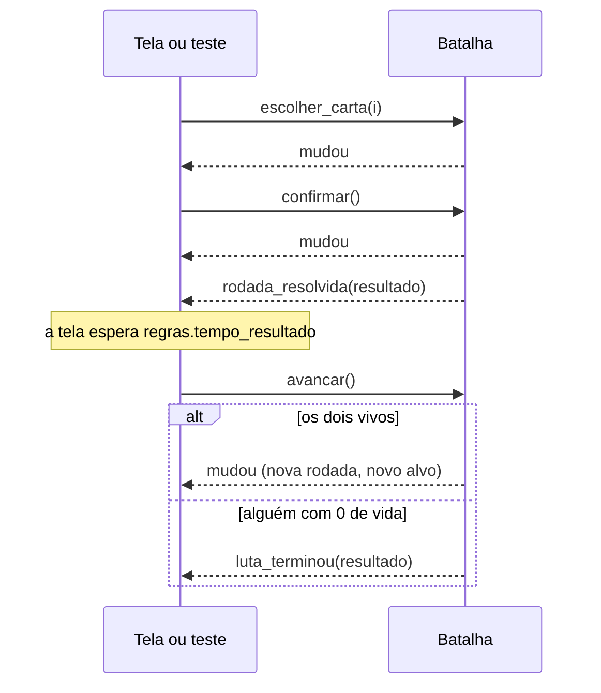

# Contrato: a luta vista de fora

**Para quem**: quem for usar a luta sem mexer nela. Na 001 é a cena `luta_avulsa`; na 002
será o mapa. Há dois níveis: a **cena** (com tela) e a **lógica** (sem tela, para testes e
simulações). Tipos em [../data-model.md](../data-model.md). Sobre "batalha" (o sistema) e "luta"
(uma partida dele) nos nomes, ver a convenção no início do data-model.

A regra dos dois níveis é a mesma: quem chama **entrega** o baralho, a vida do Arthur, o
inimigo, as regras e a semente, e **recebe** o resultado por sinal. A luta não lê arquivo de
dados por conta própria, não guarda nada entre lutas e não decide o que vem depois.

## Nível 1: a cena `batalha/tela_batalha.tscn`

```gdscript
class_name TelaBatalha
extends Control

## Emitido uma vez, depois que o resultado da última rodada saiu da tela.
signal luta_terminou(resultado: ResultadoLuta)

## A lógica da luta em andamento (criada por iniciar()). Quem usa a cena só lê;
## os testes de cena escrevem nela para montar um cenário (mão, alvo, vidas).
var batalha: Batalha

## Começa a luta. Chamar depois de pôr a cena na árvore.
func iniciar(
		cartas: Array[DadosCarta],
		vida_arthur: int,
		dados_inimigo: DadosInimigo,
		regras: RegrasBatalha,
		semente: int) -> void
```

| Parâmetro | Quem define na 001 | Quem define na 002 |
|---|---|---|
| `cartas` | `baralho_luta_avulsa.tres` (21 cartas) | o baralho da run |
| `vida_arthur` | `regras.vida_maxima_arthur` (40) | a vida que sobrou da casa anterior |
| `dados_inimigo` | `inimigo_padrao.tres` | o inimigo da casa do mapa |
| `regras` | `regras_batalha.tres` | as regras da profundidade atual |
| `semente` | `randi()` (uma luta diferente a cada vez) | a critério da run |

Pré-condição: `cartas` tem pelo menos uma carta de número. Com isso, toda mão de início de
rodada tem um número (a compra dirigida da FR-006 o traz, e no começo da rodada a expressão
está vazia), e um número sozinho já é uma conta válida, então o alvo é sempre alcançável.

Garantias:
- `cartas` não é alterado: a luta trabalha numa cópia.
- `vida_arthur` pode ser menor que `regras.vida_maxima_arthur`; a cura respeita a máxima.
- `luta_terminou` sai exatamente uma vez por `iniciar()`.
- `resultado.vida_arthur` é a vida a levar para a próxima luta.
- A cena não mostra tela de vitória ou derrota, não reinicia a luta e não troca de cena.
- Com a mesma semente, os mesmos dados e os mesmos cliques, a luta é idêntica.
- `batalha` fica acessível para testes: um teste de cena pode pôr cartas na mão, definir o
  alvo ou a vida do inimigo pela `batalha` e depois clicar na tela, sem depender do sorteio.
  Depois de mexer nos campos, o teste emite `batalha.mudou` para a tela redesenhar.

Exemplo de uso (é o que a `luta_avulsa` faz):

```gdscript
var tela: TelaBatalha = CENA_BATALHA.instantiate()
add_child(tela)
tela.luta_terminou.connect(_ao_terminar_luta)
tela.iniciar(baralho.cartas, regras.vida_maxima_arthur, inimigo, regras, randi())
```

## Nível 2: a lógica `batalha/batalha.gd`

Não é nó. Pode ser criada e jogada inteira num teste ou numa simulação, sem cena.

```gdscript
class_name Batalha
extends RefCounted

enum Estado { MONTANDO, MOSTRANDO_RESULTADO, TERMINADA }

## Algo visível mudou (mão, expressão, vidas, escudo, alvo): a tela se redesenha.
signal mudou
## A rodada foi resolvida; a tela mostra o resultado e depois chama avancar().
signal rodada_resolvida(resultado: ResultadoRodada)
## Alguém chegou a 0 de vida e avancar() foi chamado.
signal luta_terminou(resultado: ResultadoLuta)

func _init(
		cartas: Array[DadosCarta],
		vida_arthur: int,
		dados_inimigo: DadosInimigo,
		regras: RegrasBatalha,
		semente: int) -> void

func iniciar() -> void                       # começa a rodada 1
func escolher_carta(indice_da_mao: int) -> void
func desfazer() -> void
func limpar() -> void
func pode_confirmar() -> bool                # false com a expressão vazia
func confirmar() -> void
func pular() -> void
func avancar() -> void                       # próxima rodada ou fim da luta
```

Regras de uso:
- As ações do jogador (`escolher_carta`, `desfazer`, `limpar`, `confirmar`, `pular`) só
  valem no estado `MONTANDO`. Em outro estado, ou com índice inválido, não fazem nada e não
  emitem sinal.
- `avancar()` só vale no estado `MOSTRANDO_RESULTADO`.
- Quem conta o 1,5 s do resultado é a tela, não a lógica. Um teste chama `avancar()` logo
  depois de `confirmar()`.
- O estado pode ser lido a qualquer momento pelos campos públicos (`arthur`, `inimigo`,
  `baralho`, `alvo`, `rodada`, `estado`).

Sequência de sinais numa rodada:



## O que este contrato deixa pronto para a 002 (sem implementar)

- Baralho e vida vêm de fora e o resultado volta por sinal: o mapa só precisa guardar o
  baralho e a vida da run e repassar.
- Inimigo e regras são objetos de dados: o arquivo único de dificuldade da 002 escolhe quais
  entregar em cada profundidade.
- A lógica roda sem tela: a 002 pode simular centenas de lutas para calibrar a dificuldade.
