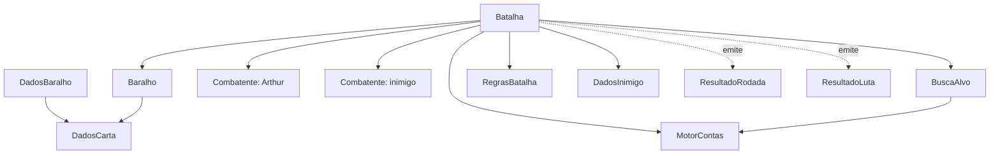
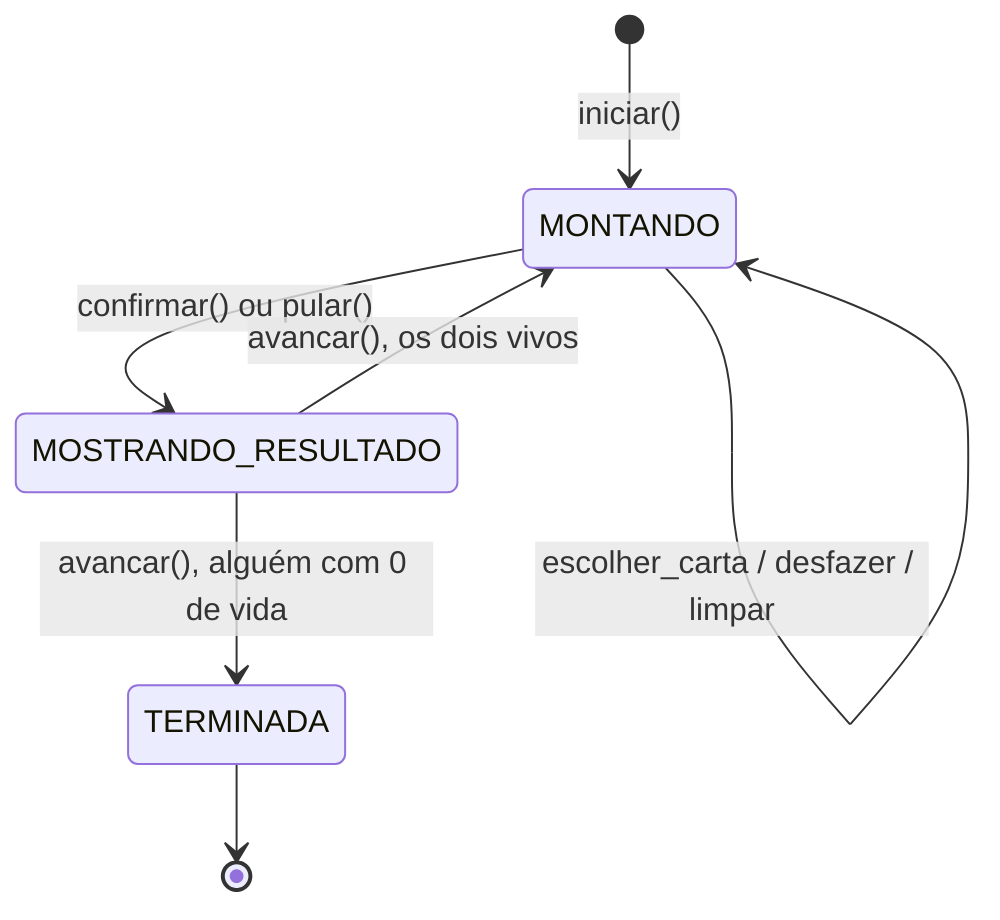

# Data Model: Núcleo da batalha (001)

**Data**: 2026-11-13 | **Plano**: [plan.md](plan.md) | **Pesquisa**: [research.md](research.md)

Dois grupos de classes: **dados** (`Resource`, salvos em `.tres` na pasta `dados/`, editados
no Inspector) e **lógica** (`RefCounted`, criados em tempo de jogo, sem depender de cena).
Nomes em português, sem acento, como pede a constituição.

Como as peças se ligam (quem usa quem):

## Dados (`Resource`)

### DadosCarta (`cartas/dados_carta.gd`)

Um arquivo `.tres` por **tipo** de carta. Duas cartas iguais no baralho apontam para o mesmo
arquivo.

| Campo | Tipo | Significado |
|---|---|---|
| `nome` | `String` | nome mostrado nas especiais ("Chama"); vazio nas comuns |
| `tipo` | `Tipo` (enum) | `NUMERO`, `SOMA`, `SUBTRACAO`, `MULTIPLICACAO`, `DIVISAO`, `DOBRO`, `METADE`, `QUADRADO` |
| `valor` | `int` | valor na conta; só para `NUMERO` |
| `ataque` | `int` | dano que a carta soma num acerto |
| `efeito` | `Efeito` (enum) | `NENHUM`, `DANO_EXTRA`, `COMPRAR`, `ESCUDO`, `CURA` |
| `intensidade` | `int` | força do efeito (3 de dano, 1 carta, 5 de escudo, 2 de cura) |

Funções de consulta (sem estado): `eh_numero()`, `eh_binario()` (+, −, ×, ÷),
`eh_unario()` (x2, /2, ^2), `simbolo()` (texto na conta: "3", "+", "−", "×", "÷", "x2",
"/2", "^2"), `texto_efeito()` ("+3 de dano", "compra 1", "+5 de escudo", "cura 2" ou vazio) e
`chave_conta()` (inteiro que identifica o tipo para a conta: cartas com a mesma chave são
intercambiáveis na busca do alvo, por exemplo o Foco e um "4").

Regras de validação:
- `valor` entre 1 e 10 quando `tipo == NUMERO`; 0 nos operadores.
- `ataque >= 0`; `intensidade >= 1` quando `efeito != NENHUM`.
- Só cartas de número têm efeito.

Arquivos da 001 (`dados/cartas/`), com os valores da tabela da spec:

| Arquivo | tipo | valor | ataque | efeito (intensidade) |
|---|---|---|---|---|
| `numero_1.tres` … `numero_5.tres` | NUMERO | 1 … 5 | 1 … 5 | — |
| `soma.tres` | SOMA | 0 | 1 | — |
| `subtracao.tres` | SUBTRACAO | 0 | 1 | — |
| `multiplicacao.tres` | MULTIPLICACAO | 0 | 3 | — |
| `divisao.tres` | DIVISAO | 0 | 3 | — |
| `dobro.tres` | DOBRO | 0 | 2 | — |
| `metade.tres` | METADE | 0 | 3 | — |
| `quadrado.tres` | QUADRADO | 0 | 4 | — |
| `chama.tres` | NUMERO | 5 | 5 | DANO_EXTRA (3) |
| `foco.tres` | NUMERO | 4 | 1 | COMPRAR (1) |
| `guarda.tres` | NUMERO | 6 | 2 | ESCUDO (5) |
| `vital.tres` | NUMERO | 7 | 3 | CURA (2) |

As cartas de número 6 a 10 da tabela da spec não entram no baralho da 001 e por isso não têm
arquivo ainda (ficam para a 002, com as recompensas).

### DadosBaralho (`cartas/dados_baralho.gd`)

| Campo | Tipo | Significado |
|---|---|---|
| `cartas` | `Array[DadosCarta]` | as cartas do baralho; carta repetida aparece duas vezes |

Arquivo: `dados/baralhos/baralho_luta_avulsa.tres`, com as 21 cartas da FR-002 (dois de cada
número de 1 a 5, soma, subtração, multiplicação, divisão, dobro, metade, quadrado, Chama,
Foco, Guarda e Vital).

### DadosInimigo (`combatentes/dados_inimigo.gd`)

| Campo | Tipo | Padrão | Significado |
|---|---|---|---|
| `nome` | `String` | "Inimigo" | nome provisório mostrado na tela |
| `vida` | `int` | 12 | vida máxima e inicial |
| `ataque` | `int` | 3 | dano por rodada |

Arquivo: `dados/inimigos/inimigo_padrao.tres`. Validação: `vida >= 1`, `ataque >= 0`.

### RegrasBatalha (`batalha/regras_batalha.gd`)

Todos os números da luta que não são de carta nem de inimigo.

| Campo | Tipo | Padrão | Requisito |
|---|---|---|---|
| `vida_maxima_arthur` | `int` | 40 | FR-001 |
| `cartas_iniciais` | `int` | 5 | FR-003 |
| `cartas_por_rodada` | `int` | 1 | FR-003 |
| `cartas_por_pulo` | `int` | 1 | FR-020 |
| `minimo_numeros` | `int` | 3 | FR-006 |
| `minimo_somas` | `int` | 1 | FR-006 |
| `minimo_subtracoes` | `int` | 1 | FR-006 |
| `alvo_minimo` | `int` | 5 | FR-007 |
| `alvo_maximo` | `int` | 12 | FR-007 |
| `max_numeros_no_alvo` | `int` | 3 | FR-007 (research D10) |
| `limite_buscas_alvo` | `int` | 10000 | teto de custo (research D10) |
| `tempo_resultado` | `float` | 1.5 | FR-025, em segundos |

Arquivo: `dados/regras_batalha.tres`. Validação: `alvo_minimo >= 1`,
`alvo_minimo <= alvo_maximo`, `max_numeros_no_alvo >= 1`, demais valores `>= 0`.

## Lógica (`RefCounted`)

### ResultadoConta (`contas/resultado_conta.gd`)

| Campo | Tipo | Significado |
|---|---|---|
| `valida` | `bool` | a sequência de cartas é uma conta válida (FR-012) |
| `valor` | `int` | resultado; só tem sentido se `valida` |

### MotorContas (`contas/motor_contas.gd`)

Só uma função estática, sem estado: `avaliar(cartas: Array[DadosCarta]) -> ResultadoConta`.

Regras (FR-012 a FR-015):
- Sequência vazia é inválida.
- Começa por número; depois de número vêm unários (zero ou mais), depois binário ou fim;
  depois de binário vem número. Qualquer outra ordem é inválida.
- Unários valem para o número logo antes, na ordem em que aparecem (`3 ^2 x2` = 18).
- × e ÷ antes de + e −; mesmo nível, da esquerda para a direita.
- ÷ e /2 arredondam para baixo (`7 ÷ 2` = 3; `1 /2` = 0; `2 − 7 ÷ 2` = −1). Dividir por zero é inválido.
- Resultado negativo é permitido.

### Combatente (`combatentes/combatente.gd`)

Usado para o Arthur e para o inimigo.

| Campo | Tipo | Significado |
|---|---|---|
| `nome` | `String` | "Arthur" ou o nome do inimigo |
| `vida` | `int` | de 0 até `vida_maxima` |
| `vida_maxima` | `int` | teto da cura |
| `escudo` | `int` | absorve dano antes da vida; `>= 0` |
| `ataque` | `int` | dano que causa por rodada (0 no Arthur) |

Operações:
- `receber_dano(quantidade) -> int`: gasta o escudo primeiro, depois a vida; a vida não fica
  negativa; devolve quanto de vida foi perdido.
- `curar(quantidade) -> int`: não passa de `vida_maxima`; devolve quanto curou de fato.
- `ganhar_escudo(quantidade)`, `zerar_escudo()`, `esta_vivo() -> bool`.

### Baralho (`cartas/baralho.gd`)

As quatro zonas da luta. Cada carta está em exatamente uma.

| Campo | Tipo | Significado |
|---|---|---|
| `compra` | `Array[DadosCarta]` | pilha de compra; o fim do array é o topo |
| `mao` | `Array[DadosCarta]` | cartas disponíveis para jogar |
| `expressao` | `Array[DadosCarta]` | conta em montagem, na ordem escolhida |
| `descarte` | `Array[DadosCarta]` | cartas já usadas |

Criação: recebe a lista de cartas e o gerador de sorteio da luta; copia a lista para
`compra` e embaralha.

Operações:
- `comprar(quantidade) -> int`: do topo da pilha para a mão. Com a pilha vazia, embaralha o
  descarte para dentro dela (FR-005). Sem cartas nas duas, para. Devolve quantas comprou.
- `comprar_com_minimo(quantidade, regras) -> void`: compra do início de rodada (FR-006,
  research D11). Enquanto faltar número, soma ou subtração na mão, compra a primeira carta
  daquele tipo na pilha (ou no descarte); depois de `quantidade` cartas, continua só se ainda
  faltar algo e houver carta daquele tipo fora da mão.
- `por_na_expressao(indice_da_mao)`: move da mão para o fim da expressão (FR-008).
- `desfazer()`: a última carta da expressão volta para o fim da mão (FR-009).
- `limpar()`: todas as cartas da expressão voltam para o fim da mão, na ordem (FR-009).
- `descartar_expressao()`: a expressão inteira vai para o descarte (FR-004, FR-019).
- `total() -> int`: soma dos tamanhos das quatro zonas.

Invariantes (viram testes):
- `total()` é sempre igual ao número de cartas recebido na criação.
- As cartas são movidas por posição, nunca procuradas por referência (duas cartas iguais são
  o mesmo objeto).
- Mesma lista e mesma semente produzem a mesma ordem de compra.

### BuscaAlvo (`contas/busca_alvo.gd`)

Criada com as `RegrasBatalha`. Algoritmo, custo e testes em [research.md](research.md), D10.

- `alcancaveis(mao: Array[DadosCarta]) -> Dictionary`: chave = valor (`int`); valor = conta
  de exemplo (`Array[DadosCarta]`) feita com cartas da mão.
- `sortear(mao: Array[DadosCarta], rng: RandomNumberGenerator) -> int`: o alvo da rodada.
- `avaliacoes: int`: quantas contas a última busca avaliou (para os testes de custo).

### ResultadoRodada (`batalha/resultado_rodada.gd`)

O que aconteceu numa rodada, para a tela mostrar (FR-025) e os testes conferirem.

| Campo | Tipo | Significado |
|---|---|---|
| `tipo` | `Tipo` (enum) | `ACERTO`, `ERRO`, `INVALIDA`, `PULO` |
| `alvo` | `int` | alvo da rodada |
| `valor` | `int` | valor da conta (em `ACERTO` e `ERRO`) |
| `dano_causado` | `int` | dano calculado: soma do ataque das cartas + Chama, mesmo que passe da vida que o inimigo ainda tinha (o aviso mostra esse número) |
| `escudo_ganho` | `int` | escudo dado ao Arthur |
| `cura` | `int` | vida que o Arthur recuperou de fato |
| `cartas_compradas` | `int` | cartas extras que entraram na mão (Foco ou Pular) |
| `inimigo_atacou` | `bool` | o inimigo atacou nesta rodada (falso só quando ele caiu nela) |
| `dano_recebido` | `int` | vida que o Arthur perdeu no ataque do inimigo (0 se o escudo segurou tudo) |
| `luta_acabou` | `bool` | alguém chegou a 0 de vida nesta rodada |

### ResultadoLuta (`batalha/resultado_luta.gd`)

O que a luta devolve a quem a chamou (na 001, a `luta_avulsa`; na 002, o mapa).

| Campo | Tipo | Significado |
|---|---|---|
| `venceu` | `bool` | `true` = o inimigo chegou a 0 |
| `vida_arthur` | `int` | vida restante do Arthur (0 na derrota) |
| `vida_inimigo` | `int` | vida restante do inimigo (0 na vitória) |
| `rodadas` | `int` | quantas rodadas a luta durou |

### Batalha (`batalha/batalha.gd`)

As regras da luta. Interface completa em [contracts/batalha.md](contracts/batalha.md).

| Campo | Tipo | Significado |
|---|---|---|
| `arthur` | `Combatente` | vida inicial recebida de fora; máxima = `regras.vida_maxima_arthur` |
| `inimigo` | `Combatente` | criado a partir de `DadosInimigo` |
| `baralho` | `Baralho` | as quatro zonas |
| `alvo` | `int` | alvo da rodada atual |
| `rodada` | `int` | número da rodada, começando em 1 |
| `estado` | `Estado` (enum) | `MONTANDO`, `MOSTRANDO_RESULTADO`, `TERMINADA` |
| `regras` | `RegrasBatalha` | números da luta |

Os campos são públicos de propósito: a tela lê para desenhar e os testes escrevem para montar
um cenário (por exemplo, pôr cartas específicas na mão e definir o alvo).

Estados:

Fora de `MONTANDO`, `escolher_carta`, `desfazer`, `limpar`, `confirmar` e `pular` não fazem
nada (FR-025: ações indisponíveis enquanto o resultado está na tela).

Ordem dos acontecimentos:

- **Começo de rodada** (`iniciar()` e `avancar()`): soma 1 em `rodada`; zera o escudo do
  Arthur (FR-018); compra com mínimo (`cartas_iniciais` na rodada 1, `cartas_por_rodada`
  nas outras); sorteia o alvo com a mão já completa; estado `MONTANDO`.
- **Confirmar com acerto** (FR-016), nesta ordem: (1) o inimigo perde a soma do `ataque`
  das cartas da expressão; (2) os efeitos de **todas** as cartas especiais usadas são
  aplicados, na ordem da conta, mesmo que o dano já tenha derrubado o inimigo (a cura e o
  escudo de um golpe final valem; decisão do Estêvão no analyze); (3) só então a expressão
  vai para o descarte, de modo que a compra do Foco nunca devolve à mão uma carta da própria
  conta; (4) se o inimigo está vivo, ele ataca o Arthur (FR-021).
- **Confirmar com erro ou conta inválida**: a expressão vai para o descarte, sem dano e sem
  efeitos (FR-019); o inimigo ataca.
- **Pular**: a expressão volta para a mão; o inimigo ataca; se o Arthur continua vivo, entram
  `cartas_por_pulo` cartas na mão (FR-020).
- Em todos os casos: monta o `ResultadoRodada`, estado `MOSTRANDO_RESULTADO`, emite
  `rodada_resolvida`.
- **Avançar**: se o inimigo ou o Arthur está com 0 de vida, estado `TERMINADA` e emite
  `luta_terminou`; senão, começo de rodada.
- `confirmar()` com a expressão vazia não faz nada (FR-011).

## Do requisito ao dado

| Entidade da spec | Onde ficou |
|---|---|
| Carta | `DadosCarta` |
| Baralho da luta | `DadosBaralho` (dado) e `Baralho` (zonas em jogo) |
| Combatente | `Combatente` (em jogo) e `DadosInimigo` (dado) |
| Rodada | campos `alvo`, `rodada` e `baralho.expressao` da `Batalha` + `ResultadoRodada` |
| Luta | `Batalha` + `ResultadoLuta` |
| Asset pendente | linha de `docs/assets-pendentes.md` |
