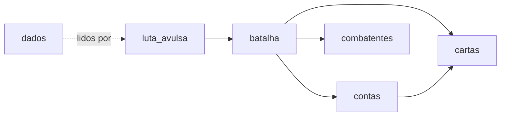

# Implementation Plan: Núcleo da batalha

**Branch**: `main` (sem ramo próprio) | **Date**: 2026-11-13 | **Spec**: [spec.md](spec.md)

**Input**: Feature specification from `/specs/001-nucleo-batalha/spec.md`

**Nota**: plano preenchido pelo comando `/speckit-plan`, que descreve o fluxo de trabalho.

## Summary

Uma luta completa do Arthur contra um inimigo: a cada rodada o jogo sorteia um alvo que a mão
consegue alcançar, o jogador monta uma conta com as cartas, e o resultado vira dano, efeitos
especiais e o ataque do inimigo, até a vitória ou a derrota.

Abordagem técnica (detalhes e fontes em [research.md](research.md)):

- **Regra separada da tela.** Toda a regra fica em classes `RefCounted` que não dependem de
  cena (`MotorContas`, `BuscaAlvo`, `Baralho`, `Combatente`, `Batalha`) e são testadas no GUT
  sem abrir tela. As cenas só mostram o estado e repassam os cliques por sinais.
- **Dados fora do código.** Cartas, baralho, inimigo e todos os números da luta são
  `Resource` em arquivos `.tres` na pasta `dados/`.
- **Sorteio com semente.** Um único `RandomNumberGenerator` por luta, com a semente recebida
  de fora.
- **Alvo sempre alcançável.** O alvo é escolhido entre os valores que uma busca encontrou
  montando contas com a própria mão, avaliadas pelo mesmo motor que julga o jogador. Custo
  medido: menos de 1 ms na faixa padrão, com teto de segurança nos dados.
- **Interface para a 002.** A luta recebe baralho, vida, inimigo, regras e semente e devolve
  o resultado por sinal ([contracts/batalha.md](contracts/batalha.md)).
- **Pixel art.** Base de 640×360, modo `viewport`, escala inteira, filtro `Nearest`.
- **Placeholders.** Nenhum asset criado; pendências em `docs/assets-pendentes.md`.

## Technical Context

**Language/Version**: GDScript com tipagem estática, Godot 4.7.2-stable

**Primary Dependencies**: nenhuma em tempo de jogo; GUT 9.7.1 (`addons/gut/`) só para testes

**Storage**: arquivos `.tres` somente leitura em `dados/` (cartas, baralho, inimigo, regras);
nada é salvo em disco nesta funcionalidade

**Testing**: GUT 9.7.1 pela linha de comando, em modo headless (comando no
[quickstart.md](quickstart.md)); testado nesta máquina com o Godot 4.7.2

**Target Platform**: PC (Windows e Linux), mouse; renderizador Compatibility

**Project Type**: jogo 2D para desktop (projeto Godot único)

**Performance Goals**: 60 fps; resultado de cada ação na tela em menos de 1 s (SC-005);
busca do alvo abaixo de 1 ms na faixa padrão e limitada a 10.000 avaliações (cerca de 35 ms
nesta máquina) no pior caso

**Constraints**: resolução base 640×360 com escala inteira; nenhum asset de arte ou som
criado; código, dados e textos em português, identificadores sem acento; a mesma semente
reproduz a mesma luta

**Scale/Scope**: 1 tela de luta + 1 tela de fim; 8 cenas pequenas; cerca de 12 scripts de
lógica e dados; 16 arquivos de carta, 1 de baralho (21 cartas), 1 de inimigo e 1 de regras

## Constitution Check

*Portão: precisa passar antes da pesquisa (fase 0) e ser conferido de novo depois do desenho
(fase 1).*

Constituição v1.0.1 (`.specify/memory/constitution.md`; a 1.0.1 só atualizou a equipe para
6 estudantes e não muda nenhuma linha desta tabela).

| Princípio | Como o plano atende | Situação |
|---|---|---|
| **I. Código Limpo e Minimalista** | Motor das contas em uma função de três níveis, sem classes de parser. Efeitos com `enum` + `match`, sem registro genérico. Uma cena `fila_cartas` serve de mão e de expressão; um `painel_combatente` serve ao Arthur e ao inimigo; um `fim_de_luta` serve à vitória e à derrota. Nada da 002 é implementado. Tipagem estática em tudo. | passa |
| **II. Testes Reais (inegociável)** | Cada área tem a sua pasta `testes/`. A lógica é testada pelo comportamento (contas de referência, força bruta como oráculo, simulação de 1.000 lutas). Cada cena é instanciada e exercitada pelos seus sinais. Sem mocks: os objetos reais são leves. Suíte roda por linha de comando. | passa |
| **III. Cenas Pequenas e Separadas** | Oito cenas, cada uma com um papel, recebendo dados por método e avisando por sinal; nenhuma usa caminho para nós de outra cena. Pastas por área, com cena, script e testes juntos. | passa |
| **IV. Assets Vêm da Equipe (inegociável)** | Só `ColorRect`, `Panel`, `Label`, fonte padrão e tocadores de áudio vazios. Lista com tipo, tamanho, quadros, formato e uso em `docs/assets-pendentes.md`, com coluna de origem e licença. | passa |
| **V. Tudo em Português** | Classes, arquivos, sinais, variáveis, comentários, textos e frases da documentação em português; identificadores sem acento em `snake_case`, classes em `PascalCase`. Ficam em inglês só os nomes do Godot e do GUT e os títulos e campos fixos do modelo do Spec Kit (ver notas abaixo). | passa, com as exceções justificadas abaixo |
| **Restrições Técnicas** | Godot 4.7.2-stable (última estável; a 4.8 ainda é beta), GDScript tipado, GUT 9.7.1 (a versão do README do GUT para o 4.7.x), com execução por linha de comando testada. | passa |
| **Fluxo de Desenvolvimento** | specify e clarify feitos; este plano confere os cinco princípios; tasks, analyze e implement vêm a seguir. | passa |

**Nota sobre nomes em inglês (princípio V)**: o GUT só reconhece funções de teste que
começam com `test_` e scripts que estendem `GutTest`, e a pasta `addons/gut/` é código de
terceiros. São nomes de ferramenta, no mesmo caso dos nomes da API do Godot que o princípio V
já mantém em inglês. Os arquivos de teste (`teste_*.gd`) e o restante do nome das funções
ficam em português. Não é uma violação; fica registrado para o `/speckit-analyze`.

**Nota sobre os títulos do Spec Kit (princípio V)**: os títulos de seção e os campos fixos
que vêm dos modelos do Spec Kit (por exemplo "Functional Requirements", "Clarifications",
"Success Criteria", "Constitution Check", "Phase 1: Setup", "Feature Branch", "Status",
"Input") ficam em inglês, porque os comandos `/speckit-*` procuram essas seções pelo nome ao
ler e escrever os arquivos (`/speckit-clarify` grava em "Clarifications", `/speckit-tasks` e
`/speckit-analyze` leem "Functional Requirements" e as fases). Traduzi-los quebraria a
ferramenta, como trocar `test_` quebraria o GUT. Todo o conteúdo abaixo desses títulos e
todas as frases livres ficam em português.

**Reavaliação depois do desenho (Fase 1)**: sem mudanças. O modelo de dados e os contratos
não acrescentaram abstração além da descrita acima. As únicas exceções são as duas de nomes
em inglês do princípio V (ferramentas e títulos do Spec Kit), justificadas nas notas acima;
nenhuma outra foi aberta.

## Project Structure

### Documentation (this feature)

```text
specs/001-nucleo-batalha/
├── plan.md              # este arquivo
├── research.md          # decisões técnicas, com a documentação do Godot 4.7 e as medições
├── data-model.md        # classes de dados e de lógica, estados e regras
├── quickstart.md        # como rodar os testes e validar jogando
├── contracts/
│   ├── batalha.md       # interface da luta (cena e lógica), pensada para a 002
│   └── tela-batalha.md  # interface de cada cena pequena e divisão da tela
├── checklists/
│   └── requirements.md
└── tasks.md             # criado pelo /speckit-tasks
```

Fora da pasta da funcionalidade: `docs/assets-pendentes.md` (lista de assets, princípio IV).

### Source Code (repository root)

```text
project.godot                 # 640×360, viewport, escala inteira, Nearest, Compatibility; sem ícone próprio
.gutconfig.json               # pastas de teste e prefixo "teste_"

addons/
└── gut/                      # GUT 9.7.1 (terceiros)

dados/                        # tudo que é equilíbrio; a 002 junta aqui a dificuldade
├── cartas/                   # 16 arquivos .tres, um por tipo de carta
├── baralhos/
│   └── baralho_luta_avulsa.tres
├── inimigos/
│   └── inimigo_padrao.tres
└── regras_batalha.tres

cartas/                       # área: cartas e baralho
├── dados_carta.gd            # Resource
├── dados_baralho.gd          # Resource
├── baralho.gd                # compra, mão, expressão, descarte
├── carta.tscn / carta.gd     # uma carta na tela
├── fila_cartas.tscn / fila_cartas.gd   # mão e expressão
└── testes/
    ├── teste_dados_carta.gd      # funções do DadosCarta (símbolo, tipo, efeito, chave)
    ├── teste_arquivos_cartas.gd  # os .tres batem com a tabela da spec; baralho tem as 21
    ├── teste_baralho.gd
    ├── teste_carta.gd
    └── teste_fila_cartas.gd

contas/                       # área: matemática
├── resultado_conta.gd
├── motor_contas.gd           # avalia a conta (FR-012 a FR-015)
├── busca_alvo.gd             # valores alcançáveis e sorteio do alvo (FR-007)
└── testes/
    ├── teste_motor_contas.gd
    └── teste_busca_alvo.gd

combatentes/                  # área: Arthur e inimigo
├── combatente.gd             # vida, escudo, dano, cura
├── dados_inimigo.gd          # Resource
├── painel_combatente.tscn / painel_combatente.gd
└── testes/
    ├── teste_combatente.gd
    ├── teste_dados_inimigo.gd
    └── teste_painel_combatente.gd

batalha/                      # área: a luta
├── regras_batalha.gd         # Resource
├── resultado_rodada.gd
├── resultado_luta.gd
├── batalha.gd                # regras da rodada, sem cena
├── aviso_rodada.tscn / aviso_rodada.gd
├── sons_batalha.tscn / sons_batalha.gd
├── tela_batalha.tscn / tela_batalha.gd
└── testes/
    ├── teste_regras_batalha.gd
    ├── teste_batalha.gd      # rodadas, erro, Pular, efeitos e quem os recebe
    ├── teste_simulacao.gd    # 1.000 lutas com semente (SC-002, SC-003, SC-008)
    ├── teste_aviso_rodada.gd
    ├── teste_sons_batalha.gd
    └── teste_tela_batalha.gd

luta_avulsa/                  # área: a luta solta da 001 (o mapa da 002 entra no lugar)
├── luta_avulsa.tscn / luta_avulsa.gd   # cena principal do projeto
├── fim_de_luta.tscn / fim_de_luta.gd   # vitória e derrota
└── testes/
    ├── teste_fim_de_luta.gd
    └── teste_luta_avulsa.gd

docs/                         # com .gdignore
specs/                        # com .gdignore
```

**Structure Decision**: projeto Godot único na raiz do repositório, organizado **por área do
jogo** (princípio III e recomendação da documentação de organização de projeto): cada área
tem os seus scripts, as suas cenas e uma subpasta `testes/`. Os dados de equilíbrio ficam
todos em `dados/`, separados do código. `docs/` e `specs/` recebem um arquivo `.gdignore`
para o Godot não os importar.

Dependências entre as áreas (uma seta = "usa"):



`cartas` e `combatentes` não dependem de ninguém; `contas` só conhece `DadosCarta`. Os
números da `RegrasBatalha` de que o `Baralho` (mínimos da mão) e a `BuscaAlvo` (faixa e
freios da busca) precisam chegam a eles como parâmetros, passados pela `Batalha`, para não
criar a volta `batalha → cartas → batalha`. Isso dá a ordem natural de construção e permite
que pessoas diferentes trabalhem em áreas diferentes.

## Ordem de construção sugerida

Para o `/speckit-tasks` detalhar. Cada passo termina com os testes da área passando e com
commit.

1. **Projeto**: `project.godot` com as configurações do research (D2, D3), GUT em
   `addons/gut/`, `.gutconfig.json`, `.gdignore`, e a suíte rodando vazia.
2. **Cartas (dados)**: `DadosCarta`, `DadosBaralho`, os 16 `.tres`, o baralho de 21 cartas e
   o teste que confere os valores com a tabela da spec.
3. **Contas**: `MotorContas` com as contas de referência (SC-004).
4. **Combatentes e baralho**: `Combatente`, `DadosInimigo`, `Baralho` com a compra dirigida.
5. **Busca do alvo**: `BuscaAlvo` com o teste de força bruta e os freios.
6. **Batalha (lógica)**: `RegrasBatalha`, resultados e `Batalha`, cobrindo as quatro
   histórias; depois a simulação de 1.000 lutas. Aqui a história 1 (P1) já está provada sem
   tela.
7. **Cenas pequenas**: `carta`, `fila_cartas`, `painel_combatente`, `aviso_rodada`,
   `sons_batalha`.
8. **Tela de luta e luta avulsa**: `tela_batalha`, `fim_de_luta`, `luta_avulsa` como cena
   principal.
9. **Validação**: quickstart inteiro e conferência de `docs/assets-pendentes.md`.

## Decisões que mudaram a spec neste plano

- **FR-006** (mão mínima): o jogo nunca tira cartas da mão; a compra já vem do tipo que falta
  (resposta do Estêvão em 13/11). Registrado em "Clarifications" da spec.
- **FR-007** (alvo): o alvo é alcançável com no máximo 3 cartas de número, valor nos dados
  (limita o custo da busca e é uma alavanca de dificuldade para a 002).

## Complexity Tracking

Nenhuma violação da constituição a justificar. As exceções de nomes do princípio V estão
justificadas no Constitution Check e não acrescentam complexidade ao código.
