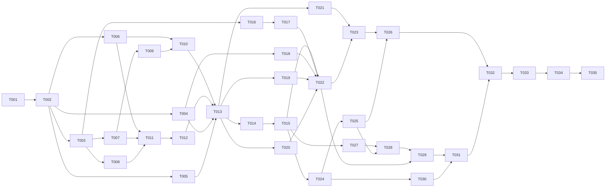

---

description: "Lista de tarefas da funcionalidade 001, núcleo da batalha"
---

# Tasks: Núcleo da batalha

**Input**: documentos de `specs/001-nucleo-batalha/` ([plan.md](plan.md), [spec.md](spec.md),
[research.md](research.md), [data-model.md](data-model.md), [contracts/](contracts/),
[quickstart.md](quickstart.md))

**Tests**: obrigatórios (constituição, princípio II). Cada tarefa escreve os testes **junto**
com o código que eles testam, no mesmo commit.

**Organization**: as fases seguem a "Ordem de construção sugerida" do plano. Dentro de cada
fase as tarefas estão agrupadas por área do jogo (cartas, contas, combatentes, batalha,
cenas, luta avulsa). As fases 3 a 6 correspondem às histórias da spec e levam o rótulo
`[US1]` a `[US4]`.

## Regras para toda tarefa

- **Uma tarefa = um commit**, em português, terminando com a suíte inteira passando:
  `godot --headless --path . --import` (quando criar classe ou `.tres`) e
  `godot --headless --path . -s addons/gut/gut_cmdln.gd` (ver [quickstart.md](quickstart.md)).
- Os testes da tarefa ficam em `<área>/testes/teste_<assunto>.gd`, estendem `GutTest` e as
  funções começam com `test_` (exigência do GUT); o resto do nome em português.
- Testes reais: criar os objetos de verdade e conferir o comportamento. Proibido
  `assert_true(true)`, teste que só confere mock ou teste ajustado para esconder defeito.
- GDScript com tipagem estática; identificadores sem acento, em `snake_case`; classes em
  `PascalCase`; textos do jogo em português com acento.
- Nenhum número de equilíbrio solto no código: tudo vem de `RegrasBatalha`, `DadosInimigo`
  ou `DadosCarta` (FR-028).
- Todo sorteio usa o `RandomNumberGenerator` recebido; nunca `Array.shuffle()`,
  `pick_random()`, `randi()` ou `randf()` soltos dentro da lógica da luta (research D8).
- Nenhuma imagem ou som é criado (princípio IV). Placeholder novo → linha em
  `docs/assets-pendentes.md`.
- Cartas movidas entre zonas sempre por **posição** no array, nunca procurando a carta,
  porque cartas iguais são o mesmo objeto (research, "Riscos").
- Antes de dar a tarefa como concluída (constituição, "Fluxo de Desenvolvimento"): rodar a
  suíte inteira, conferir que não sobrou código morto ou comentado (função, variável, sinal,
  nó ou arquivo que ninguém usa, `print` de depuração) e listar, no relato da tarefa, os
  assets pedidos que continuam pendentes.

## Format: `[ID] [P?] [Story] Description`

- **[P]**: pode ser feita em paralelo por outra pessoa (arquivos diferentes, sem depender de
  tarefa ainda aberta)
- **[Story]**: história da spec atendida (US1 a US4)

---

## Phase 1: Setup (projeto)

**Purpose**: projeto Godot configurado e suíte de testes rodando pela linha de comando.

- [ ] T001 Criar `project.godot` com o Godot 4.7.2 (nome "Answer Quest") e as configurações do research D2 e D3: `rendering/renderer/rendering_method="gl_compatibility"` (e `.mobile` igual), `display/window/size/viewport_width=640`, `viewport_height=360`, `window_width_override=1280`, `window_height_override=720`, `display/window/stretch/mode="viewport"`, `stretch/aspect="keep"`, `stretch/scale_mode="integer"`, `rendering/textures/canvas_textures/default_texture_filter=0`, `rendering/2d/snap/snap_2d_transforms_to_pixel=true`; não definir `application/config/icon` nem criar `icon.svg` (o Godot usa o ícone padrão dele, placeholder da linha "Ícone do jogo" de `docs/assets-pendentes.md`); criar os arquivos vazios `docs/.gdignore` e `specs/.gdignore`; conferir que `.gitignore` ignora `.godot/`
- [ ] T002 Copiar o GUT 9.7.1 (`https://github.com/bitwes/Gut/archive/refs/tags/v9.7.1.zip`, pasta `addons/gut/`) para `addons/gut/`, ativar o plugin em `project.godot` (`[editor_plugins] enabled=PackedStringArray("res://addons/gut/plugin.cfg")`) e criar `.gutconfig.json` com `"dirs": ["res://cartas/testes", "res://contas/testes", "res://combatentes/testes", "res://batalha/testes", "res://luta_avulsa/testes"]`, `"include_subdirs": true`, `"prefix": "teste_"`, `"suffix": ".gd"`, `"should_exit": true`, `"log_level": 1`; criar as cinco pastas `testes/` (com `.gitkeep`) e conferir que o comando da suíte roda sem erro de carregamento do GUT (sem testes ainda)

**Checkpoint**: `godot --headless --path . -s addons/gut/gut_cmdln.gd` executa e fecha sozinho.

---

## Phase 2: Foundational (dados e regras básicas)

**Purpose**: as peças de que todas as histórias dependem: cartas, contas, combatentes,
baralho e busca do alvo, todas sem cena.

**⚠️ CRITICAL**: nenhuma tarefa de história começa antes desta fase terminar.

### Área: cartas (dados)

- [ ] T003 [P] Criar `DadosCarta` em `cartas/dados_carta.gd` (`class_name DadosCarta extends Resource`) com `enum Tipo { NUMERO, SOMA, SUBTRACAO, MULTIPLICACAO, DIVISAO, DOBRO, METADE, QUADRADO }`, `enum Efeito { NENHUM, DANO_EXTRA, COMPRAR, ESCUDO, CURA }`, campos `@export` `nome`, `tipo`, `valor`, `ataque`, `efeito`, `intensidade` e as funções `eh_numero()`, `eh_binario()`, `eh_unario()`, `simbolo()` ("3", "+", "−", "×", "÷", "x2", "/2", "^2"), `texto_efeito()` ("+3 de dano", "compra 1", "+5 de escudo", "cura 2" ou "") e `chave_conta()` (mesmo inteiro para cartas intercambiáveis na conta, ex.: Foco e "4"), conforme [data-model.md](data-model.md); testes em `cartas/testes/teste_dados_carta.gd` cobrindo cada função para número, cada operador e cada especial

### Área: combatentes

- [ ] T004 [P] Criar `Combatente` em `combatentes/combatente.gd` (`extends RefCounted`) com `nome`, `vida`, `vida_maxima`, `escudo`, `ataque` e `receber_dano(quantidade) -> int` (escudo primeiro, vida nunca negativa, devolve a vida perdida), `curar(quantidade) -> int` (teto em `vida_maxima`, devolve o curado de fato), `ganhar_escudo()`, `zerar_escudo()`, `esta_vivo()`; testes em `combatentes/testes/teste_combatente.gd` (escudo maior e menor que o dano, dano maior que a vida, cura acima do máximo, vida inicial menor que a máxima)
- [ ] T005 [P] Criar `DadosInimigo` em `combatentes/dados_inimigo.gd` (`extends Resource`, `@export` `nome`, `vida`, `ataque`) e `dados/inimigos/inimigo_padrao.tres` com "Inimigo", 12, 3; testes em `combatentes/testes/teste_dados_inimigo.gd` carregando o `.tres` e conferindo os valores da FR-001 e as regras de validação do [data-model.md](data-model.md) (`vida >= 1`, `ataque >= 0`)

### Área: batalha (dados)

- [ ] T006 [P] Criar `RegrasBatalha` em `batalha/regras_batalha.gd` (`extends Resource`) com os 12 campos `@export` da tabela do [data-model.md](data-model.md) e `dados/regras_batalha.tres` com os valores padrão (40, 5, 1, 1, 3, 1, 1, 5, 12, 3, 10000, 1.5); testes em `batalha/testes/teste_regras_batalha.gd` carregando o `.tres` e conferindo cada valor e as regras de validação do [data-model.md](data-model.md) (`alvo_minimo >= 1`, `alvo_minimo <= alvo_maximo`, `max_numeros_no_alvo >= 1`, demais `>= 0`)

### Área: cartas (arquivos de dados e baralho)

- [ ] T007 Criar os 16 arquivos de `dados/cartas/` da tabela do [data-model.md](data-model.md) (`numero_1.tres` a `numero_5.tres`, `soma`, `subtracao`, `multiplicacao`, `divisao`, `dobro`, `metade`, `quadrado`, `chama`, `foco`, `guarda`, `vital`), `DadosBaralho` em `cartas/dados_baralho.gd` (`@export var cartas: Array[DadosCarta]`) e `dados/baralhos/baralho_luta_avulsa.tres` com as 21 cartas da FR-002; testes em `cartas/testes/teste_dados_cartas.gd` conferindo valor, ataque, efeito e intensidade de cada arquivo contra a tabela da spec e as regras de validação do [data-model.md](data-model.md) (valor de 1 a 10 só nos números e 0 nos operadores, `ataque >= 0`, `intensidade >= 1` com efeito, efeito só em número) e a composição exata do baralho (2 de cada número de 1 a 5 e 1 de cada uma das outras 11) (depende de T003)

### Área: contas (motor)

- [ ] T008 [P] Criar `ResultadoConta` em `contas/resultado_conta.gd` (`valida: bool`, `valor: int`) e `MotorContas` em `contas/motor_contas.gd` com `static func avaliar(cartas: Array[DadosCarta]) -> ResultadoConta`, em três níveis (fator com unários; termo com × e ÷; soma com + e −), divisão e metade com `floori(a / float(b))`, divisão por zero inválida, regras da FR-012 a FR-015 (research D9); testes parametrizados em `contas/testes/teste_motor_contas.gd` com pelo menos 30 contas de referência (SC-004), incluindo `3 + 4 × 2 = 11`, `3 ^2 x2 = 18`, `2 − 5 + 9 = 6`, `7 ÷ 2 = 3`, `5 /2 = 2`, `1 /2 = 0`, `2 − 7 ÷ 2 = −1` (a divisão é feita antes da subtração), `5 = 5` (uma carta só) e as inválidas `3 4`, `+ 3`, `5 ×`, `4 ÷ 1 /2` (divisão por zero: o `1 /2` vale 0 e vem antes do ÷), `3 + x2`, `^2 3`, lista vazia (depende de T003; paralela a T007)

### Área: cartas (baralho em jogo)

- [ ] T009 Criar `Baralho` em `cartas/baralho.gd` (`extends RefCounted`) com as zonas `compra`, `mao`, `expressao`, `descarte` (`Array[DadosCarta]`), `_init(cartas, rng)` copiando e embaralhando com Fisher–Yates usando `rng.randi_range()`, `comprar(quantidade) -> int` (embaralha o descarte para a compra quando ela acaba; para se as duas estiverem vazias), `por_na_expressao(indice)`, `desfazer()`, `limpar()`, `descartar_expressao()` e `total()`; testes em `cartas/testes/teste_baralho.gd` (a lista recebida não é alterada, `total()` constante depois de qualquer sequência de operações, recompra pelo descarte, compra com tudo vazio, mesma semente → mesma ordem, semente diferente → ordem diferente, desfazer e limpar devolvendo na ordem) (depende de T007)
- [ ] T010 Acrescentar `comprar_com_minimo(quantidade, regras)` em `cartas/baralho.gd` conforme FR-006 e research D11: enquanto faltar número, soma ou subtração na mão (mínimos de `RegrasBatalha`, atendidos nessa ordem), comprar a carta daquele tipo mais perto do topo da compra (busca a partir do fim do array) ou, se não houver, a descartada há mais tempo (busca a partir do início do descarte); depois das `quantidade` cartas, comprar extras só do tipo que ainda falta; nunca tirar carta da mão; testes em `cartas/testes/teste_baralho.gd` (mão inicial sempre 3 números, + e −; mão com 2 cartas recebe só o que falta; mão já completa recebe exatamente `quantidade`; baralho sem subtração fora da mão → melhor mão possível, sem travar; com dois "−" na compra, sai o mais perto do topo; sem "−" na compra e dois no descarte, sai o descartado primeiro) (depende de T006 e T009)

### Área: contas (busca do alvo)

- [ ] T011 [P] Criar `BuscaAlvo` em `contas/busca_alvo.gd` (`extends RefCounted`, `_init(regras)`) com `alcancaveis(mao) -> Dictionary` (valor → conta de exemplo) e o contador `avaliacoes`, seguindo o algoritmo do research D10 (agrupar por `chave_conta()`, gramática da FR-012, avaliar com `MotorContas.avaliar`, limite crescente de números até `max_numeros_no_alvo`, parada antecipada quando a faixa inteira foi achada, teto `limite_buscas_alvo`); testes em `contas/testes/teste_busca_alvo.gd`: comparação com força bruta (todas as ordens de todos os subconjuntos) em pelo menos 50 mãos de 3 a 6 cartas sorteadas com semente fixa e `max_numeros_no_alvo` alto; cada conta de exemplo usa só cartas da mão, no máximo uma vez cada, e dá o valor; nenhuma conta de exemplo passa de `max_numeros_no_alvo` números; com as 21 cartas na mão e faixa impossível (5.000 a 6.000: o baralho só tem um ×, um x2 e um ^2, e o maior valor possível é `7 x2 ^2 × 6 + 5` = 1.181), `avaliacoes <= limite_buscas_alvo` e nenhum valor da faixa achado (depende de T006, T007 e T008; paralela a T009 e T010)
- [ ] T012 Acrescentar `sortear(mao, rng) -> int` em `contas/busca_alvo.gd` (sorteia entre os valores achados dentro da faixa, em ordem crescente; sem nenhum na faixa, o valor positivo achado mais próximo da faixa, sorteando entre os dois se um abaixo e um acima empatam na distância; mão sem números, `alvo_minimo`); testes em `contas/testes/teste_busca_alvo.gd` (alvo sempre com conta de exemplo; dentro da faixa quando possível; mão `1, 1, 2, +, −` → alvo 3, porque com um só `+` o maior valor possível é `2 + 1`; empate com faixa 5 a 12 e valores achados 3 e 14 (dicionário montado à mão, pela função interna que escolhe o alvo) → em sementes diferentes saem os dois, e nada além deles; mesma semente → mesmo alvo) (depende de T011)

**Checkpoint**: toda a regra matemática e o baralho funcionam e estão testados, sem nenhuma cena.

---

## Phase 3: User Story 1 - Vencer uma luta montando contas (Priority: P1) 🎯 MVP

**Goal**: uma luta jogável do começo à vitória: alvo, mão, montar a conta, confirmar, dano,
ataque do inimigo, carta nova, alvo novo e tela de vitória com "Lutar de novo". Uma conta
errada ou inválida já gasta as cartas e passa a vez (T014), para a luta nunca travar; a
derrota e os testes da história 2 vêm na fase 4.

**Independent Test**: abrir o jogo e acertar alvos até o inimigo cair, conferindo o dano de
cada acerto, o ataque do inimigo a cada rodada, a carta nova por rodada e a tela de vitória
(quickstart, cenário 2).

### Área: batalha (lógica)

- [ ] T013 [US1] Criar `ResultadoRodada` em `batalha/resultado_rodada.gd` e `ResultadoLuta` em `batalha/resultado_luta.gd` com os campos do [data-model.md](data-model.md), e `Batalha` em `batalha/batalha.gd` (`extends RefCounted`) com os sinais `mudou`, `rodada_resolvida`, `luta_terminou`, `enum Estado { MONTANDO, MOSTRANDO_RESULTADO, TERMINADA }`, `_init(cartas, vida_arthur, dados_inimigo, regras, semente)` (um só `RandomNumberGenerator` com a semente, passado ao `Baralho` e à `BuscaAlvo`) e `iniciar()` (rodada 1: zera escudo, `comprar_com_minimo(regras.cartas_iniciais)`, sorteia o alvo, estado `MONTANDO`, emite `mudou`), conforme [contracts/batalha.md](contracts/batalha.md); testes em `batalha/testes/teste_batalha.gd` (Arthur com a vida recebida e máxima 40, escudo 0; inimigo cheio; mão de 5 com o mínimo; alvo alcançável com a mão; lista de cartas recebida intacta; mesma semente → mesma mão e mesmo alvo)
- [ ] T014 [US1] Acrescentar em `batalha/batalha.gd` `escolher_carta(indice)`, `pode_confirmar()`, `confirmar()` com os três desfechos: **acerto** (inimigo perde a soma do `ataque` das cartas, `ResultadoRodada` tipo `ACERTO`), **erro** (sem dano, tipo `ERRO` com o `valor` obtido) e **conta inválida** (sem dano, tipo `INVALIDA`), FR-016 e FR-019; nos três a expressão vai para o descarte, o inimigo vivo ataca o Arthur, o estado vira `MOSTRANDO_RESULTADO` e sai `rodada_resolvida` (assim o MVP nunca trava numa conta errada; efeitos especiais ficam para o T030) e `avancar()` (nova rodada: soma 1 em `rodada`, zera escudo do Arthur, `comprar_com_minimo(regras.cartas_por_rodada)`, novo alvo); ações fora de `MONTANDO` e índice inválido não fazem nada; `confirmar()` com expressão vazia não faz nada; testes em `batalha/testes/teste_batalha.gd`, incluindo o cenário 2 da história 1 (inimigo com 20 de vida, alvo 11, `3 + 4 × 2` → 13 de dano, sobra 7, Arthur perde 3) o cenário 3 (mão completa recebe exatamente 1 carta) uma conta errada (inimigo intacto, cartas no descarte, tipo `ERRO`) e o acerto com uma carta só (edge case da spec, com as cartas da 001: alvo 5 e a mão com um 5; confirmar só o 5 é `ACERTO` com 5 de dano, o ataque dela) (depende de T013)
- [ ] T015 [US1] Acrescentar a vitória em `batalha/batalha.gd`: acerto que zera o inimigo não tem ataque do inimigo e marca `luta_acabou`; `avancar()` então vai para `TERMINADA` e emite `luta_terminou` com `ResultadoLuta` (`venceu = true`, vidas, rodadas), uma única vez; testes em `batalha/testes/teste_batalha.gd` (cenário 4 da história 1; Arthur não perde vida no golpe final e o resultado tem `inimigo_atacou = false`; `dano_causado` é o dano calculado mesmo passando da vida restante; nenhuma ação vale depois de `TERMINADA`) (depende de T014)

### Área: cenas (peças da tela)

- [ ] T016 [P] [US1] Criar `cartas/carta.tscn` (raiz `Button`, 48×64) com `cartas/carta.gd`: sinal `clicada`, `mostrar(dados)` com símbolo no canto superior esquerdo, ataque num canto de baixo, nome e efeito resumido nas especiais e `tooltip_text` com o efeito completo (FR-024); placeholder `Panel` + `Label`; testes em `cartas/testes/teste_carta.gd` (textos de número, operador e especial; `clicada` emitido ao pressionar) (depende de T003)
- [ ] T017 [US1] Criar `cartas/fila_cartas.tscn` (raiz `HBoxContainer`) com `cartas/fila_cartas.gd`: `@export var clicavel`, sinal `carta_escolhida(indice)`, `mostrar(cartas)` recriando as cartas na ordem e reduzindo a separação (até sobrepor) quando passa de 600 px; testes em `cartas/testes/teste_fila_cartas.gd` (quantidade e ordem das cartas; índice certo no sinal; nada emitido com `clicavel = false`; 21 cartas cabem em 600 px) (depende de T016)
- [ ] T018 [P] [US1] Criar `combatentes/painel_combatente.tscn` (raiz `VBoxContainer`) com `combatentes/painel_combatente.gd`: `mostrar(combatente)` com placeholder `ColorRect` 64×64, nome, "vida / vida_maxima", escudo só se maior que 0 e ataque só se maior que 0 ([contracts/tela-batalha.md](contracts/tela-batalha.md)); testes em `combatentes/testes/teste_painel_combatente.gd` (Arthur com e sem escudo; inimigo mostrando ataque) (depende de T004)
- [ ] T019 [P] [US1] Criar `batalha/aviso_rodada.tscn` (raiz `Label`) com `batalha/aviso_rodada.gd`: `mostrar(resultado)` e `esconder()` com os textos da tabela de [contracts/tela-batalha.md](contracts/tela-batalha.md) para `ACERTO` (com escudo, cura e compra quando houver), `ERRO`, `INVALIDA`, `PULO` e a linha do ataque do inimigo, só quando `inimigo_atacou` ("O inimigo tirou 3 de vida." ou, com `dano_recebido` 0, "O escudo segurou o ataque."); testes em `batalha/testes/teste_aviso_rodada.gd` com um `ResultadoRodada` de cada tipo e um acerto final sem ataque (sem a segunda linha) (depende de T013)
- [ ] T020 [P] [US1] Criar `batalha/sons_batalha.tscn` (raiz `Node`) com `batalha/sons_batalha.gd`: um `AudioStreamPlayer` sem áudio para cada evento (carta, acerto, erro, pulo, dano recebido) e um para a música da luta com `autoplay = true` (sem código), `tocar_carta()` e `tocar_rodada(resultado)`, que só tocam se o tocador tiver `stream`; testes em `batalha/testes/teste_sons_batalha.gd` (sem áudio, nenhuma chamada gera erro; com um `AudioStreamWAV.new()` atribuído em memória ao tocador de acerto, `tocar_rodada` de um acerto deixa esse tocador com `playing == true` e os outros parados; o tocador de música existe e tem `autoplay` ligado) (depende de T013)
- [ ] T021 [P] [US1] Criar `luta_avulsa/fim_de_luta.tscn` (raiz `Control`) com `luta_avulsa/fim_de_luta.gd`: sinal `jogar_de_novo`, `mostrar(resultado)` com os textos de vitória da tabela de [contracts/tela-batalha.md](contracts/tela-batalha.md) ("Vitória!", "Vida do Arthur: N", "Rodadas: N", botão "Lutar de novo") e também os de derrota, e dois `AudioStreamPlayer` sem áudio (vitória e derrota), tocando o certo só se tiver `stream`; testes em `luta_avulsa/testes/teste_fim_de_luta.gd` (textos dos dois casos; botão emite `jogar_de_novo`; sem áudio nada dá erro; com um `AudioStreamWAV.new()` no tocador de vitória, uma vitória o deixa tocando) (depende de T013)

### Área: cenas (tela de luta) e luta avulsa

- [ ] T022 [US1] Criar `batalha/tela_batalha.tscn` (raiz `Control`, 640×360, divisão da tela do contrato) com `batalha/tela_batalha.gd` (`class_name TelaBatalha`): `iniciar(cartas, vida_arthur, dados_inimigo, regras, semente)` criando a `Batalha` no campo público `batalha` ([contracts/batalha.md](contracts/batalha.md)); dois `painel_combatente`, `Label` do alvo, `fila_cartas` da expressão (não clicável) e da mão, botão Confirmar, `aviso_rodada`, `sons_batalha` e um `Timer` de disparo único; a cada `mudou` redesenha e desabilita Confirmar se `pode_confirmar()` for falso; a cada `rodada_resolvida` mostra o aviso, toca o som, desabilita mão e botões e liga o `Timer` com `regras.tempo_resultado`; no `timeout` esconde o aviso, chama `avancar()` e reabilita; repassa `luta_terminou`; nunca mostra o valor da conta em montagem (FR-010); testes em `batalha/testes/teste_tela_batalha.gd` com regras de `tempo_resultado = 0.05`, montando mão, alvo e vidas pela `tela.batalha` quando o caso pedir (clicar carta da mão a move para a expressão; Confirmar desabilitado com expressão vazia; FR-010: com a mão `2, +, 5, 1, −` e alvo 9, montar `2 + 5` deixa o aviso escondido e nenhum texto visível da tela contém "7"; SC-005: o aviso já está visível logo depois do clique em Confirmar, sem esperar nenhum quadro nem o `Timer`; durante o aviso, clicar não muda nada; depois do tempo a rodada seguinte aparece sozinha; `luta_terminou` repassado ao vencer) (depende de T015, T017, T018, T019, T020)
- [ ] T023 [US1] Criar `luta_avulsa/luta_avulsa.tscn` (raiz `Control`) com `luta_avulsa/luta_avulsa.gd`: `@export` `baralho`, `inimigo`, `regras` preenchidos com os `.tres` de `dados/`; ao abrir cria a `TelaBatalha` e chama `iniciar(baralho.cartas, regras.vida_maxima_arthur, inimigo, regras, randi())`; no `luta_terminou` remove a tela e mostra `fim_de_luta`; no `jogar_de_novo` começa outra luta do zero; guardar a tela atual no campo público `tela` (null durante o fim de luta); definir como `run/main_scene` no `project.godot`; testes em `luta_avulsa/testes/teste_luta_avulsa.gd`, trocando `regras` por uma cópia com `tempo_resultado = 0.05` antes de pôr a cena na árvore e preparando a vitória pela `tela.batalha` (inimigo com 1 de vida, mão e alvo conhecidos, clique nas cartas e em Confirmar) (luta começa ao abrir; ao vencer aparece o fim de luta; "Lutar de novo" volta à luta com vidas cheias e mão de 5) (depende de T021, T022)

**Checkpoint**: MVP jogável. A história 1 funciona sozinha e pode ser demonstrada.

---

## Phase 4: User Story 2 - Errar, apanhar e perder (Priority: P2)

**Goal**: conta errada ou inválida gasta as cartas, não causa dano e o inimigo ataca; com a
vida do Arthur em 0, aparece a derrota.

**Independent Test**: confirmar contas erradas e inválidas e conferir sem dano, cartas
gastas e Arthur apanhando; repetir até a derrota (quickstart, cenário 3).

### Área: batalha (lógica)

- [ ] T024 [US2] Testes da história 2 na lógica, sobre o `confirmar()` que o T014 já resolve: erro e conta inválida mandam a expressão para o descarte, sem dano, sem efeitos, com ataque do inimigo e `ResultadoRodada` tipo `ERRO` (com `valor`) ou `INVALIDA` (FR-019); testes em `batalha/testes/teste_batalha.gd` (cenário 1 da história 2: alvo 9, `2 + 5` → valor 7, inimigo intacto, 3 cartas no descarte; cenário 2 com `3 4`, `+ 3`, `5 ×` e `4 ÷ 1 /2`); corrigir `batalha/batalha.gd` se algum falhar
- [ ] T025 [US2] Acrescentar a derrota em `batalha/batalha.gd`: ataque que zera o Arthur marca `luta_acabou`; `avancar()` vai para `TERMINADA` e emite `luta_terminou` com `venceu = false`, `vida_arthur = 0` e a vida do inimigo; testes em `batalha/testes/teste_batalha.gd` (cenário 3 da história 2; vida nunca negativa; escudo absorve antes da vida) (depende de T024)

### Área: cenas e luta avulsa

- [ ] T026 [US2] Testes de integração da derrota e do erro em `batalha/testes/teste_tela_batalha.gd` (aviso "Errou: a conta deu 7, o alvo era 9." e "Conta inválida. O alvo era 9." aparecem na tela) e em `luta_avulsa/testes/teste_luta_avulsa.gd` (derrota mostra "Derrota", "Vida do inimigo: N" e "Tentar de novo", que recomeça a luta); corrigir `batalha/tela_batalha.gd` ou `luta_avulsa/luta_avulsa.gd` se algum falhar (depende de T023, T025)

**Checkpoint**: histórias 1 e 2 funcionando juntas.

---

## Phase 5: User Story 3 - Corrigir a conta e usar o Pular (Priority: P2)

**Goal**: desfazer a última carta, limpar a conta e pular a rodada trocando vida por cartas.

**Independent Test**: montar e desmontar contas conferindo a mão; pular e conferir a vida e
o tamanho da mão (quickstart, cenário 4).

### Área: batalha (lógica)

- [ ] T027 [US3] Acrescentar `desfazer()` e `limpar()` em `batalha/batalha.gd` (repassam ao `Baralho`, emitem `mudou`, não encerram a rodada, só valem em `MONTANDO`); testes em `batalha/testes/teste_batalha.gd` (cenários 1 e 2 da história 3: `3 + 4` → desfazer → `3 +` e o 4 de volta na mão; limpar devolve tudo e `pode_confirmar()` fica falso)
- [ ] T028 [US3] Acrescentar `pular()` em `batalha/batalha.gd` (FR-020): expressão volta para a mão, inimigo ataca, se o Arthur continua vivo entram `regras.cartas_por_pulo` cartas, `ResultadoRodada` tipo `PULO` com `cartas_compradas`; testes em `batalha/testes/teste_batalha.gd` (cenário 3 da história 3: mão de 5 com o mínimo → 7 cartas depois de `avancar()`; pular com cartas na expressão as devolve; pular que zera o Arthur leva à derrota sem comprar) (depende de T025, que traz a derrota, e de T027)

### Área: cenas

- [ ] T029 [US3] Acrescentar os botões Desfazer, Limpar e Pular em `batalha/tela_batalha.tscn` e `batalha/tela_batalha.gd`, ligados a `desfazer()`, `limpar()` e `pular()`, desabilitados durante o aviso; testes em `batalha/testes/teste_tela_batalha.gd` (cada botão muda a mão e a expressão como na lógica; Pular mostra "Pulou a rodada. Comprou 1 carta."; botões não fazem nada durante o aviso) (depende de T022, que cria a tela, e de T028)

**Checkpoint**: histórias 1, 2 e 3 funcionando juntas.

---

## Phase 6: User Story 4 - Cartas especiais (Priority: P3)

**Goal**: Chama, Foco, Guarda e Vital aplicam o efeito certo, no alvo certo, só no acerto.

**Independent Test**: acertar contas com cada especial e conferir o efeito; errar com uma
especial e conferir que nada acontece (quickstart, cenário 5).

### Área: batalha (lógica)

- [ ] T030 [US4] Acrescentar a aplicação dos efeitos em `batalha/batalha.gd` (research D13): uma função com `match` em `DadosCarta.Efeito`: `DANO_EXTRA` → `inimigo.receber_dano()`, `COMPRAR` → `baralho.comprar()`, `ESCUDO` → `arthur.ganhar_escudo()`, `CURA` → `arthur.curar()`; aplicada na ordem da FR-016: dano das cartas, depois os efeitos de todas as especiais da conta na ordem em que aparecem (mesmo que o inimigo já tenha caído), depois a expressão para o descarte e por último o ataque do inimigo vivo; preencher `dano_causado`, `escudo_ganho`, `cura` e `cartas_compradas` do `ResultadoRodada`; testes em `batalha/testes/teste_batalha.gd` conferindo **os dois lados** de cada efeito: Chama tira +3 do inimigo e não mexe no Arthur; Foco põe 1 carta na mão antes do ataque; Guarda dá 5 de escudo ao Arthur, absorve o ataque 3, o escudo do inimigo continua 0 e o do Arthur volta a 0 na rodada seguinte; Vital cura o Arthur sem passar de 40 (39 → 40) e a vida do inimigo não sobe; nenhum efeito numa conta errada (cenários 1 a 5 da história 4); golpe final com a Vital cura o Arthur e não tem ataque do inimigo; Foco com a pilha de compra vazia não compra nenhuma carta da própria conta; Foco com as duas pilhas vazias não faz nada e a luta segue (edge case da spec); Chama que dá o golpe final (o inimigo só cai com os +3) leva à vitória sem ataque do inimigo (depende de T024, que traz a conta errada)

### Área: cenas

- [ ] T031 [US4] Testes de integração das especiais em `batalha/testes/teste_tela_batalha.gd`: depois de um acerto com a Guarda, o painel do Arthur mostra o escudo e o aviso mostra "+5 de escudo." e "O escudo segurou o ataque."; na rodada seguinte o escudo some do painel; o painel do inimigo nunca mostra escudo; corrigir `batalha/tela_batalha.gd` ou `combatentes/painel_combatente.gd` se algum falhar (depende de T029, T030)

**Checkpoint**: as quatro histórias funcionando juntas.

---

## Phase 7: Polish & Cross-Cutting Concerns

**Purpose**: provas em escala, pendências de assets e validação final.

- [ ] T032 Criar `batalha/testes/teste_simulacao.gd` com 1.000 lutas de sementes diferentes jogadas só pela lógica (`Batalha` com o baralho de 21 cartas e os `.tres` padrão) por um jogador automático que alterna entre a conta de exemplo da `BuscaAlvo` para o alvo da rodada, uma conta errada e o Pular: em toda rodada o alvo tem conta de exemplo com cartas da mão (SC-002); toda mão de início de rodada cumpre o mínimo quando o baralho tem cartas para isso (SC-003); `baralho.total()` fica constante; toda luta termina; nenhuma busca chega ao teto (`avaliacoes < limite_buscas_alvo` em toda rodada, ou seja, o teto nunca cortou uma busca; "não passa do teto" seria verdade por construção e não provaria nada); repetir 20 sementes com as mesmas ações dá exatamente as mesmas lutas (SC-008)
- [ ] T033 Atualizar `docs/assets-pendentes.md` com os placeholders que existem de fato nas cenas (cor de cada `ColorRect`, nós de texto, tocadores de áudio vazios), confirmando que cada placeholder visual e sonoro das cenas tem uma linha (SC-006) e que não há arquivo de imagem ou som criado para o jogo
- [ ] T034 Validação automática do [quickstart.md](quickstart.md), feita pelo agente: rodar a suíte inteira pela linha de comando (cenário 1, tudo passando), abrir o jogo pelo MCP do Godot (`run_project`, `get_debug_output`) e conferir que não sai nenhum erro nem aviso ao carregar a luta, e fazer o cenário 8 lendo as cenas (`.tscn`) e o repositório: cada placeholder tem linha em `docs/assets-pendentes.md` e não há imagem ou som criado; registrar no fim do `quickstart.md` a data e o resultado dos cenários 1 e 8 (o MCP não clica no jogo, por isso os cenários jogados ficam no T035)
- [ ] T035 Validação jogada do [quickstart.md](quickstart.md), feita por **uma pessoa da equipe** (não pelo agente): abrir o jogo e percorrer os cenários 2 a 7 com o mouse; registrar no fim do `quickstart.md` a data, quem jogou e o resultado de cada cenário (passou ou o que falhou); cada falha vira uma tarefa de correção nova neste arquivo, com teste que reproduz o defeito (princípio II)

---

## Dependencies & Execution Order

### Ordem das fases

1. **Setup (fase 1)**: começa já.
2. **Foundational (fase 2)**: depende da fase 1 e bloqueia todas as histórias.
3. **US1 (fase 3)**: depende da fase 2. É o MVP.
4. **US2 (fase 4)** e **US3 (fase 5)**: dependem da US1 (precisam da `Batalha` e da tela).
   A US3 depende da US2 num ponto só: o T028 testa o Pular que leva à derrota, que vem do
   T025. Fora isso, só disputam os arquivos `batalha/batalha.gd` e
   `batalha/tela_batalha.gd`; podem ser feitas por pessoas diferentes se uma esperar o commit
   da outra nesses arquivos.
5. **US4 (fase 6)**: a lógica (T030) depende da US1 e do T024 (testa que a conta errada não
   aplica efeito); o teste de tela (T031) depende da US3 (usa a tela com todos os botões).
6. **Polish (fase 7)**: depois de todas as histórias.

### Dependências entre tarefas



### Dentro de cada tarefa

- Escrever o teste e o código juntos (de preferência o teste primeiro, vendo-o falhar).
- Rodar a suíte inteira, não só a da área.
- Commit só com tudo passando.

## Parallel Example: trabalho da equipe

Depois de T002, até quatro pessoas começam ao mesmo tempo, cada uma numa área:

```text
Pessoa A (cartas):      T003 → T007 → T009 → T010
Pessoa B (combatentes): T004 → T005 → T018
Pessoa C (batalha):     T006 → (espera T003) T008 → T011 → T012
Pessoa D (cenas):       (espera T003) T016 → T017
```

Na US1, depois de T013:

```text
Pessoa A: T014 → T015 (lógica da batalha)
Pessoa B: T019 (aviso_rodada)
Pessoa C: T020 (sons_batalha)
Pessoa D: T021 (fim_de_luta)
```

Depois da US1: uma pessoa na US2 (T024 → T025 → T026), outra na US3 (T027, depois
`(espera T025)` T028 → T029), outra na lógica da US4 (`(espera T024)` T030), combinando a
ordem dos commits em `batalha/batalha.gd`.

---

## Implementation Strategy

### MVP primeiro (só a história 1)

1. Fase 1 (setup) e fase 2 (fundação).
2. Fase 3 (US1).
3. **Parar e validar**: cenário 2 do quickstart. Já é uma luta jogável para mostrar.

### Entrega incremental

1. Setup + fundação → regra matemática testada.
2. + US1 → luta jogável até a vitória (MVP).
3. + US2 → erro e derrota.
4. + US3 → desfazer, limpar e Pular.
5. + US4 → cartas especiais.
6. Polish → simulação, assets e validação do quickstart (a parte jogada, T035, é de uma
   pessoa da equipe).

Cada passo acrescenta valor sem quebrar o anterior, porque a suíte inteira roda a cada
commit.

## Notes

- **Prazo da visão**: funcionalidade 001 até 17/11.
- O plano (research D13) aponta o erro do jogo antigo em que Guarda e Vital ajudavam o
  inimigo; o T030 tem que conferir os dois lados de cada efeito.
- Placeholders novos que aparecerem durante as tarefas entram em `docs/assets-pendentes.md`
  na própria tarefa; o T033 só confere e completa.
