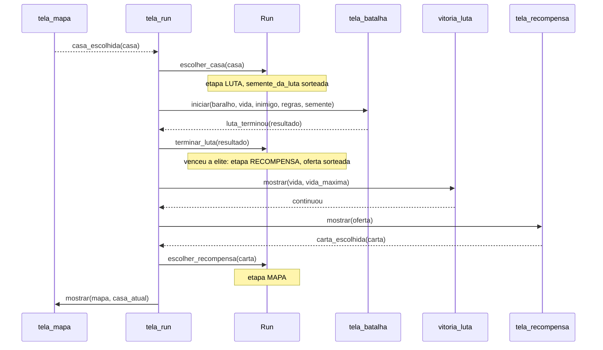

# Contrato: a run vista de fora

**Para quem**: quem for montar as telas da run, escrever testes ou mexer nela na 003 e na 004.
Há dois níveis, como na luta da 001: a **lógica** `Run` (sem tela) e a **cena principal**
`run/tela_run.tscn`, que junta a `Run` com as telas. Tipos e regras no
[data-model.md](../data-model.md).

## Nível 1: a lógica `run/run.gd`

Não é nó. Pode ser criada e jogada inteira num teste, sem cena.

```gdscript
class_name Run
extends RefCounted

enum Etapa { MAPA, LUTA, CHEFE, DESCANSO, RECOMPENSA, VITORIA, DERROTA }

var semente: int
var dificuldade: DadosDificuldade
var ato: int                       # de 1 até dificuldade.atos.size()
var mapas: Array[MapaAto]          # um por ato, gerados na criação
var casa_atual: Casa               # null antes do primeiro andar de cada ato
var vida_arthur: int
var vida_maxima: int
var baralho: Array[DadosCarta]
var lutas_vencidas: int
var etapa: Etapa
var oferta: Array[DadosCarta]      # só na etapa RECOMPENSA
var cura: int                      # quanto o último descanso curou
var semente_da_luta: int           # sorteada ao entrar numa casa de luta ou de chefe

## Pré-condição: dificuldade.erros() vazio (quem cria confere antes).
func _init(dificuldade_da_run: DadosDificuldade, semente_da_run: int) -> void

func mapa() -> MapaAto
func dados_do_ato() -> DadosAto
func ultimo_ato() -> bool
func casas_disponiveis() -> Array[Casa]           # vazia fora da etapa MAPA
func escolher_casa(casa: Casa) -> bool            # false e nada muda se não vale
func inimigo_da_luta() -> DadosInimigo            # da casa atual (LUTA ou CHEFE)
func regras_da_luta() -> RegrasBatalha            # regras_base com a faixa do ato
func terminar_luta(resultado: ResultadoLuta) -> void
func sair_do_descanso() -> void
func escolher_recompensa(carta: DadosCarta) -> void   # null = não pegar nenhuma
func andar_alcancado() -> int
```

O fim da run se lê na `etapa` (`VITORIA` ou `DERROTA`); não há função `terminou()`.

Regras de uso:

- Cada método de transição só vale na sua etapa (tabela no data-model); fora dela não faz nada.
- A `Run` não conhece cena nenhuma, não sorteia nada fora do próprio gerador e não lê arquivo:
  recebe os dados prontos.
- A `Run` nunca altera os objetos de `dificuldade` (cartas, inimigos, regras): o que ela entrega
  para a luta (`baralho`, `inimigo_da_luta()`, `regras_da_luta()`) pode ser passado direto para
  `TelaBatalha.iniciar()`, que também não altera nada (contrato da 001).
- Mesma semente, mesmos dados e mesmas chamadas, mesma run (FR-006).

Exemplo: entrar numa casa de luta e levar o resultado de volta (é o que a cena principal faz):

```gdscript
if run.escolher_casa(casa) and run.etapa == Run.Etapa.LUTA:
    tela.iniciar(run.baralho, run.vida_arthur, run.inimigo_da_luta(), run.regras_da_luta(), run.semente_da_luta)
    var resultado: ResultadoLuta = await tela.luta_terminou
    run.terminar_luta(resultado)
```

(A cena principal usa sinais conectados, não `await`; o exemplo só mostra a ordem.)

## Nível 2: a cena principal `run/tela_run.tscn`

Cena principal do projeto (`application/run/main_scene`). Raiz `Control` de tela inteira.

```gdscript
extends Control

## O arquivo de dificuldade (no editor: dados/dificuldade.tres). Nos testes, trocado antes
## de pôr a cena na árvore.
@export var dificuldade: DadosDificuldade

## A run em andamento; null se o arquivo de dificuldade tem erro.
var run: Run
```

Comportamento:

1. Ao entrar na árvore, chama `dificuldade.erros()`. Com erro: mostra o aviso de dados errados
   (texto em [telas-run.md](telas-run.md)), chama `push_error()` para cada frase e para por
   aí (FR-028). Sem erro: começa uma run com semente `randi()` (FR-001, FR-006).
2. Na etapa `MAPA`: mostra a barra da run e o mapa (`tela_mapa.mostrar(run.mapa(),
   run.casa_atual)`). Ao `casa_escolhida(casa)`: `run.escolher_casa(casa)` e abre a etapa nova.
3. Cada etapa abre uma cena, que é criada, conectada e iniciada; quando o sinal dela chega, a
   cena principal chama a `Run` e libera a cena (research D8). Enquanto ela está aberta, o mapa
   e a barra ficam escondidos.

   | Etapa | Cena aberta | Entrada | Sinal | O que a cena principal faz no sinal |
   |---|---|---|---|---|
   | `LUTA` | `batalha/tela_batalha.tscn` (001) | `iniciar(run.baralho, run.vida_arthur, run.inimigo_da_luta(), run.regras_da_luta(), run.semente_da_luta)` | `luta_terminou(resultado)` | `run.terminar_luta(resultado)`; se venceu, abre o aviso de vitória; se perdeu, vai para a etapa nova (`DERROTA`) |
   | `CHEFE` | a mesma, por `_abrir_chefe()` | igual à `LUTA` | igual | igual |
   | (depois de luta vencida) | `run/vitoria_luta.tscn` | `mostrar(run.vida_arthur, run.vida_maxima)` | `continuou` | abre a etapa em que a `Run` já está (`MAPA`, `RECOMPENSA` ou `VITORIA`) |
   | `DESCANSO` | `descanso/tela_descanso.tscn` | `mostrar(run.cura, run.vida_arthur, run.vida_maxima)` | `continuou` | `run.sair_do_descanso()` |
   | `RECOMPENSA` | `recompensa/tela_recompensa.tscn` | `mostrar(run.oferta)` | `carta_escolhida(carta)` ou `nenhuma_escolhida` | `run.escolher_recompensa(carta)` ou `run.escolher_recompensa(null)` |
   | `VITORIA` ou `DERROTA` | `run/fim_de_run.tscn` | `mostrar(run)` | `jogar_de_novo` | começa uma run nova com semente `randi()` (FR-024, SC-006) |

Sequência de uma casa de elite vencida:



## Ponto de troca para a 003 (chefes e a prova)

A 002 deixa a casa de chefe pronta para ser trocada sem mexer no mapa, nas casas nem na `Run`
(FR-018, orientação 5):

```gdscript
## Ponto de troca da 003: hoje o chefe é uma luta comum mais forte (FR-018).
func _abrir_chefe() -> void:
    _abrir_luta()
```

O que a 003 pode fazer, e o que ela precisa manter:

| A 003 quer | Onde muda | O que não muda |
|---|---|---|
| chefes dos atos 1 e 2 como elites reforçadas | só os campos `chefe` dos atos em `dados/dificuldade.tres` (nome, vida, ataque) | código nenhum |
| a prova no lugar do chefe do último ato | só o corpo de `_abrir_chefe()`: abre a cena da prova quando `run.ultimo_ato()` | a cena da prova tem que avisar o fim com `luta_terminou(resultado: ResultadoLuta)`, como a luta da 001; a cena principal chama `run.terminar_luta(resultado)` do mesmo jeito, e a `Run` decide vitória ou derrota da run |

## O que este contrato deixa pronto para a 004 (sem implementar)

- O menu principal pode criar a cena principal no lugar de abri-la direto; nada nela depende de
  ser a primeira cena.
- A tela de derrota e a cena final da 004 podem ocupar o lugar de `fim_de_run` lendo a `Run`
  (`etapa`, `ato`, `andar_alcancado()`, `lutas_vencidas`).
- Nada é salvo em disco (spec, Assumptions): a run vive só na memória.
