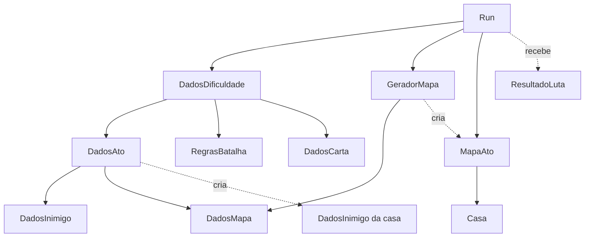
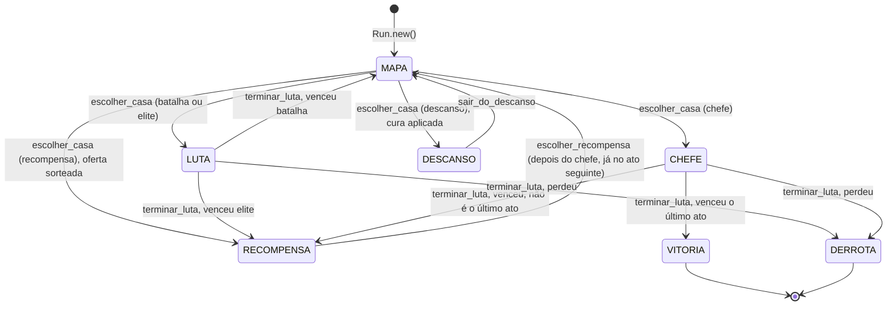

# Data Model: Run e mapa (002)

**Data**: 2026-11-18 | **Plano**: [plan.md](plan.md) | **Pesquisa**: [research.md](research.md)

Como na 001, dois grupos de classes: **dados** (`Resource`, salvos em `.tres` na pasta
`dados/`, editados no Inspector) e **lógica** (`RefCounted`, criados em tempo de jogo, sem
depender de cena). As classes da 001 (`DadosCarta`, `DadosInimigo`, `RegrasBatalha`,
`ResultadoLuta`, `Batalha`) são usadas sem mudança; os campos delas estão no
[data-model da 001](../001-nucleo-batalha/data-model.md).

Convenção de nomes: **run** é a palavra da visão e da spec para uma tentativa inteira, do
calabouço até a vitória ou a derrota (classe `Run`, pasta `run/`); **casa** é um ponto do mapa;
**andar** é a linha de casas de um ato (andar 1 embaixo, chefe no topo); **etapa** é o que a run
está fazendo agora (no mapa, numa luta, num descanso...).

Como as peças se ligam (quem usa quem):

## Dados (`Resource`)

Diferente da 001, os dados da run **são conferidos com o jogo rodando** (FR-028, research
D6): cada classe tem `erros() -> Array[String]`, com uma frase por valor impossível. Todas as
frases citam o nome do campo como aparece no Inspector.

### DadosMapa (`mapa/dados_mapa.gd`)

O tamanho do mapa de um ato e quantas casas de cada tipo ele tem (FR-008, FR-011). Fica dentro
de cada `DadosAto`.

| Campo | Tipo | Padrão | Significado |
|---|---|---|---|
| `andares_comuns` | `int` | 4 | andares antes do chefe |
| `casas_minimas_por_andar` | `int` | 2 | menor número de casas de um andar comum |
| `casas_maximas_por_andar` | `int` | 3 | maior número de casas de um andar comum |
| `batalhas_primeiro_andar` | `int` | 3 | casas do andar 1 (todas de batalha) |
| `batalhas` | `int` | 3 | batalhas do andar 2 em diante |
| `elites` | `int` | 1 | elites (só do andar 3 em diante) |
| `descansos` | `int` | 2 | descansos (pelo menos um no último andar comum) |
| `recompensas` | `int` | 2 | recompensas |

Função: `casas_acima_do_primeiro() -> int` = `batalhas + elites + descansos + recompensas` (8
no padrão).

Constantes: `MAXIMO_CASAS_POR_ANDAR = 7` e `MAXIMO_ANDARES_COMUNS = 8`, o que cabe na tela do
mapa ([contracts/telas-run.md](contracts/telas-run.md)). Não são equilíbrio: vêm da disposição
da tela, e o teste da `tela_mapa` confere que esses máximos cabem e que um a mais não cabe.

`erros()`, nesta ordem (as regras 7 a 9 só são conferidas se as de 1 a 6 passaram, porque
dependem delas; as 10 e 11 são sempre conferidas):

1. `andares_comuns` menor que 2: o andar 1 só tem batalhas e o último andar comum precisa de
   um descanso, então são pelo menos dois andares ("mapa sem andares" da FR-028).
2. `casas_minimas_por_andar` menor que 1.
3. `casas_minimas_por_andar` maior que `casas_maximas_por_andar`.
4. `batalhas_primeiro_andar` fora de `max(2, casas_minimas_por_andar)` a
   `casas_maximas_por_andar` (com menos de 2 não há dois caminhos; FR-010).
5. `batalhas`, `elites`, `descansos` ou `recompensas` negativo.
6. `descansos` igual a 0 ("ato sem casa de descanso").
7. `casas_acima_do_primeiro()` fora de `(andares_comuns − 1) × casas_minimas_por_andar` a
   `(andares_comuns − 1) × casas_maximas_por_andar` ("mais casas de um tipo do que o ato
   comporta", ou menos do que o mínimo).
8. `elites` maior que 0 com `andares_comuns` menor que 3 ("elite sem andar acima do 2").
9. `elites` maior que as vagas do andar 3 em diante no pior caso, que é o andar 2 sair com o
   máximo de casas: `T − min(casas_maximas_por_andar, T − (andares_comuns − 2) ×
   casas_minimas_por_andar) − 1`, com `T = casas_acima_do_primeiro()` (o −1 é o descanso
   reservado no último andar comum). No padrão: 8 − 3 − 1 = 4 vagas para 1 elite.
10. `casas_maximas_por_andar` maior que `MAXIMO_CASAS_POR_ANDAR`: as casas das pontas sairiam
    da tela ("mapa que não cabe na tela" da FR-028). O andar 1 fica coberto junto, porque a
    regra 4 já o limita a `casas_maximas_por_andar`.
11. `andares_comuns` maior que `MAXIMO_ANDARES_COMUNS`: os andares ficariam a menos de 32 px um
    do outro e as casas se sobreporiam ("mapa que não cabe na tela").

### DadosAto (`run/dados_ato.gd`)

Tudo o que muda de um ato para outro. Os três ficam dentro de `DadosDificuldade.atos`.

| Campo | Tipo | Significado |
|---|---|---|
| `nome` | `String` | nome mostrado na barra da run ("Calabouço") |
| `alvo_minimo` | `int` | faixa do alvo das lutas do ato (FR-026) |
| `alvo_maximo` | `int` | |
| `comum` | `DadosInimigo` | nome, vida e ataque do inimigo comum no andar 1 do ato |
| `elite` | `DadosInimigo` | o mesmo para a elite |
| `chefe` | `DadosInimigo` | o chefe provisório (FR-018); a 003 muda só estes valores nos atos 1 e 2 |
| `vida_extra_por_andar` | `int` | quanto a vida do comum e da elite sobe a cada andar |
| `mapa` | `DadosMapa` | tamanho e casas do mapa do ato |

Funções (sem estado; nunca devolvem um objeto dos dados, sempre um novo, para ninguém alterar o
arquivo carregado; research D5):

- `inimigo(tipo: Casa.Tipo, andar: int) -> DadosInimigo`: `BATALHA` → `comum` com vida +
  `vida_extra_por_andar × (andar − 1)`; `ELITE` → o mesmo a partir de `elite`; `CHEFE` → cópia
  de `chefe`, sem acréscimo. Para descanso e recompensa, `null`.
- `regras_da_luta(base: RegrasBatalha) -> RegrasBatalha`: `base.duplicate()` com `alvo_minimo`
  e `alvo_maximo` do ato.

`erros()` (o `DadosDificuldade` põe "Ato N (nome): " na frente de cada frase):

- `alvo_minimo` menor que 1; `alvo_minimo` maior que `alvo_maximo` ("faixa de alvo
  invertida").
- `comum`, `elite` ou `chefe` vazio; `vida` ou `ataque` de algum deles menor que 1.
- `vida_extra_por_andar` negativo.
- `mapa` vazio; senão, as frases de `mapa.erros()`.

### DadosDificuldade (`run/dados_dificuldade.gd`)

O arquivo único de equilíbrio da run (FR-027, research D5).

| Campo | Tipo | Significado |
|---|---|---|
| `regras_base` | `RegrasBatalha` | as regras da luta da 001 (vida máxima do Arthur, mão, freios da busca); a faixa do alvo vem do ato |
| `baralho_inicial` | `Array[DadosCarta]` | baralho do começo de toda run (FR-002) |
| `cartas_de_recompensa` | `Array[DadosCarta]` | conjunto de onde saem as ofertas (FR-021) |
| `cartas_por_recompensa` | `int` | cartas em cada oferta |
| `cura_do_descanso` | `int` | porcentagem da vida máxima que o descanso cura (FR-020) |
| `atos` | `Array[DadosAto]` | na ordem da run; o último é o que termina a run |

`erros()`:

- `regras_base` vazio.
- `atos` vazio; alguma posição de `atos` vazia; depois, as frases de cada ato.
- `baralho_inicial` sem nenhuma carta de número (ou com posição vazia). A luta exige pelo menos
  um número no baralho (pré-condição do contrato da 001).
- `cartas_de_recompensa` com posição vazia. A lista vazia **vale** (spec, casos-limite: a
  recompensa avisa que não há cartas).
- `cartas_por_recompensa` menor que 1.
- `cura_do_descanso` fora de 0 a 100.

### Arquivo padrão: `dados/dificuldade.tres`

Um arquivo só. Os três `DadosAto`, os seus `DadosInimigo` e os seus `DadosMapa` ficam dentro
dele como sub-recursos; as cartas e as regras são arquivos da 001 apontados por ele.

| Campo | Valor padrão |
|---|---|
| `regras_base` | `dados/regras_batalha.tres` |
| `baralho_inicial` | `numero_1` a `numero_5`, duas vezes cada, `soma`, `subtracao`, `multiplicacao` (13 cartas) |
| `cartas_de_recompensa` | `numero_6` a `numero_10`, `multiplicacao`, `divisao`, `dobro`, `metade`, `quadrado`, `chama`, `foco`, `guarda`, `vital` (14 cartas) |
| `cartas_por_recompensa` | 3 |
| `cura_do_descanso` | 30 (12 de vida com a máxima de 40) |

| Ato | `nome` | Alvo | `comum` (vida / ataque) | `elite` | `chefe` | `vida_extra_por_andar` |
|---|---|---|---|---|---|---|
| 1 | Calabouço | 5 a 12 | Inimigo do calabouço, 12 / 3 | Elite do calabouço, 18 / 4 | Chefe do calabouço, 26 / 5 | 1 |
| 2 | Salões | 8 a 18 | Inimigo dos salões, 18 / 4 | Elite dos salões, 26 / 5 | Chefe dos salões, 36 / 6 | 1 |
| 3 | Torre | 12 a 24 | Inimigo da torre, 24 / 5 | Elite da torre, 34 / 6 | Chefe da torre, 46 / 7 | 1 |

Os três `mapa` usam os padrões de `DadosMapa` (4 andares comuns de 2 a 3 casas; 3 batalhas no
andar 1; 3 batalhas, 1 elite, 2 descansos e 2 recompensas nos andares 2 a 4). Os nomes dos
inimigos são provisórios (spec, FR-027).

### Cartas novas (`dados/cartas/`)

Os números 6 a 10 entram agora, para o conjunto de recompensas, com os valores da tabela de
cartas da spec da 001:

| Arquivo | tipo | valor | ataque |
|---|---|---|---|
| `numero_6.tres` … `numero_10.tres` | NUMERO | 6 … 10 | 3, 4, 4, 5, 6 |

O teste `cartas/testes/teste_arquivos_cartas.gd` ganha essas 5 linhas (research D1).

### Conferência dos dados padrão (SC-004)

Um teste carrega `dados/dificuldade.tres` e confere, com `DadosAto.inimigo()` em todos os
andares de todos os atos:

- `erros()` vazio;
- o baralho inicial é o da FR-002 e as 14 cartas de recompensa são diferentes entre si;
- dentro de cada ato, vida e ataque do comum e da elite nunca diminuem de um andar para o
  seguinte;
- de um ato para o seguinte, a faixa do alvo (mínimo e máximo), a vida e o ataque de cada tipo
  de inimigo crescem, e o comum do andar 1 do ato seguinte não tem menos vida que o comum do
  último andar comum do ato anterior (o mesmo para a elite);
- a elite tem mais vida e mais ataque que o comum do mesmo andar;
- o chefe tem mais vida e mais ataque que a elite do último andar comum do ato.

## Lógica (`RefCounted`)

### Casa (`mapa/casa.gd`)

| Campo | Tipo | Significado |
|---|---|---|
| `tipo` | `Tipo` (enum) | `BATALHA`, `ELITE`, `DESCANSO`, `RECOMPENSA`, `CHEFE` |
| `andar` | `int` | 1 é o primeiro; `andares_comuns + 1` é o do chefe |
| `indice` | `int` | posição no andar, da esquerda para a direita, a partir de 0 |
| `ligacoes` | `Array[Casa]` | casas do andar seguinte ligadas a esta, em ordem de `indice` (vazio no chefe) |
| `visitada` | `bool` | o Arthur já passou por ela nesta run |

A profundidade (FR-025) não é guardada nem calculada: é a ordem (ato, andar), e os dados a
seguem (um `DadosAto` por ato e `DadosAto.inimigo(tipo, andar)` dentro dele).

### MapaAto (`mapa/mapa_ato.gd`)

| Campo | Tipo | Significado |
|---|---|---|
| `casas` | `Array[Casa]` | todas as casas, por andar e, dentro do andar, por `indice` |
| `total_de_andares` | `int` | `andares_comuns + 1` |

A lista é uma só (e não uma lista por andar) porque o GDScript ainda não aceita listas tipadas
dentro de listas tipadas (research D5).

Funções:

- `casas_do_andar(andar: int) -> Array[Casa]`, em ordem de `indice`.
- `disponiveis(atual: Casa) -> Array[Casa]`: com `atual` nulo (antes do primeiro andar), as
  casas do andar 1; senão, `atual.ligacoes` (FR-013). É o único lugar com essa regra: a `Run` e
  a tela do mapa usam esta função.

Não há função para achar o chefe: o jogo não precisa dela (o gerador cria o chefe, e a `Run`
reconhece a casa pelo `tipo`). Os testes o acham com `casas_do_andar(total_de_andares)`.

### GeradorMapa (`mapa/gerador_mapa.gd`)

Só uma função estática: `gerar(dados: DadosMapa, semente: int) -> MapaAto`. Pré-condição:
`dados.erros()` vazio. Cria um `RandomNumberGenerator` com a semente e faz os três passos do
research D4 (tamanho dos andares, tipos, ligações em escada). Mesma semente e mesmos dados, mesmo
mapa.

### Run (`run/run.gd`)

O estado e as regras da run (orientação 1). Interface completa em
[contracts/run.md](contracts/run.md).

| Campo | Tipo | Significado |
|---|---|---|
| `semente` | `int` | semente da run (FR-006) |
| `dificuldade` | `DadosDificuldade` | os dados conferidos no começo |
| `ato` | `int` | de 1 até `dificuldade.atos.size()` |
| `mapas` | `Array[MapaAto]` | um por ato, todos gerados na criação (research D3) |
| `casa_atual` | `Casa` | onde o Arthur está; nulo antes do primeiro andar de cada ato |
| `vida_arthur` | `int` | vida da run (FR-003), de 0 a `vida_maxima` |
| `vida_maxima` | `int` | `regras_base.vida_maxima_arthur`; não muda nesta funcionalidade |
| `baralho` | `Array[DadosCarta]` | cópia do baralho inicial mais as cartas escolhidas (FR-004) |
| `lutas_vencidas` | `int` | para o fim de run (FR-024) |
| `etapa` | `Etapa` (enum) | `MAPA`, `LUTA`, `CHEFE`, `DESCANSO`, `RECOMPENSA`, `VITORIA`, `DERROTA` |
| `oferta` | `Array[DadosCarta]` | cartas da recompensa aberta; vazia fora da etapa `RECOMPENSA` |
| `cura` | `int` | quanto o último descanso curou de fato (para a tela mostrar) |
| `semente_da_luta` | `int` | sorteada ao entrar numa casa de luta ou de chefe |

Os campos são públicos de propósito, como na `Batalha`: as telas leem para desenhar e os testes
podem montar um cenário (por exemplo, `vida_arthur = 20` antes de entrar num descanso).

Etapas e transições:

O que cada transição faz:

| Método | Vale em | Efeito |
|---|---|---|
| `escolher_casa(casa)` | `MAPA`, com `casa` em `casas_disponiveis()` | `casa_atual = casa`, `casa.visitada = true`; luta ou chefe: `semente_da_luta` sorteada; descanso: cura `floori(vida_maxima × cura_do_descanso / 100.0)`, sem passar da máxima, e guarda em `cura` quanto curou de fato; recompensa: sorteia a `oferta` |
| `terminar_luta(resultado)` | `LUTA` ou `CHEFE` | derrota: `vida_arthur = 0`, etapa `DERROTA`; vitória: `vida_arthur = resultado.vida_arthur`, `lutas_vencidas += 1` e a etapa da tabela acima (elite e chefe de ato que não é o último sorteiam a `oferta`) |
| `sair_do_descanso()` | `DESCANSO` | etapa `MAPA` |
| `escolher_recompensa(carta)` | `RECOMPENSA`, com `carta` nula ou da `oferta` | carta não nula vai para o fim de `baralho`; `oferta` esvazia; se a casa atual é o chefe (`casa_atual.tipo == CHEFE`), `ato += 1` e `casa_atual = null` (FR-023); etapa `MAPA` |

Fora da etapa certa, ou com casa ou carta que não vale, o método não faz nada (e
`escolher_casa` devolve `false`). Em `VITORIA` e `DERROTA` nenhum método muda nada; a run nova é
outro `Run.new()` (FR-024).

**Oferta** (FR-021): a lista `cartas_de_recompensa` sem repetidas (a mesma carta duas vezes na
lista conta uma vez), sorteada sem repetição com o gerador da run, até `cartas_por_recompensa`
cartas. Com menos cartas no conjunto, vêm todas; com o conjunto vazio, a oferta é vazia.

Outras funções: `mapa()`, `dados_do_ato()`, `ultimo_ato() -> bool`, `casas_disponiveis()`
(vazia fora do `MAPA`), `inimigo_da_luta()` e `regras_da_luta()` (da casa atual, pelo
`DadosAto`) e `andar_alcancado() -> int` (andar da casa atual, ou 0). O fim da run se lê na
`etapa` (`VITORIA` ou `DERROTA`), que é o que a cena principal já consulta para abrir cada tela;
uma função `terminou()` só seria usada pelos testes.

Invariantes (viram testes):

- `vida_arthur` fica entre 1 e `vida_maxima`, e só é 0 em `DERROTA`.
- `baralho` é sempre o baralho inicial seguido das cartas escolhidas, na ordem.
- As casas visitadas do ato atual formam um caminho: uma por andar, do andar 1 até a
  `casa_atual`, cada uma ligada à seguinte.
- Mesma semente, mesmos dados e mesmas chamadas dão a mesma run (mapas, sementes das lutas,
  ofertas).

## Do requisito ao dado

| Entidade da spec | Onde ficou |
|---|---|
| Run | `Run` |
| Ato | `DadosAto` (dados) + `Run.ato` e `Run.mapas` (em jogo) |
| Mapa do ato | `MapaAto` (gerado por `GeradorMapa` a partir de `DadosMapa`) |
| Casa | `Casa`; a profundidade é a ordem (ato, `casa.andar`) |
| Inimigo da casa | `DadosInimigo` novo, criado por `DadosAto.inimigo()` |
| Dados de dificuldade | `DadosDificuldade` em `dados/dificuldade.tres` |
| Oferta de recompensa | `Run.oferta` + a escolha em `Run.escolher_recompensa()` |
