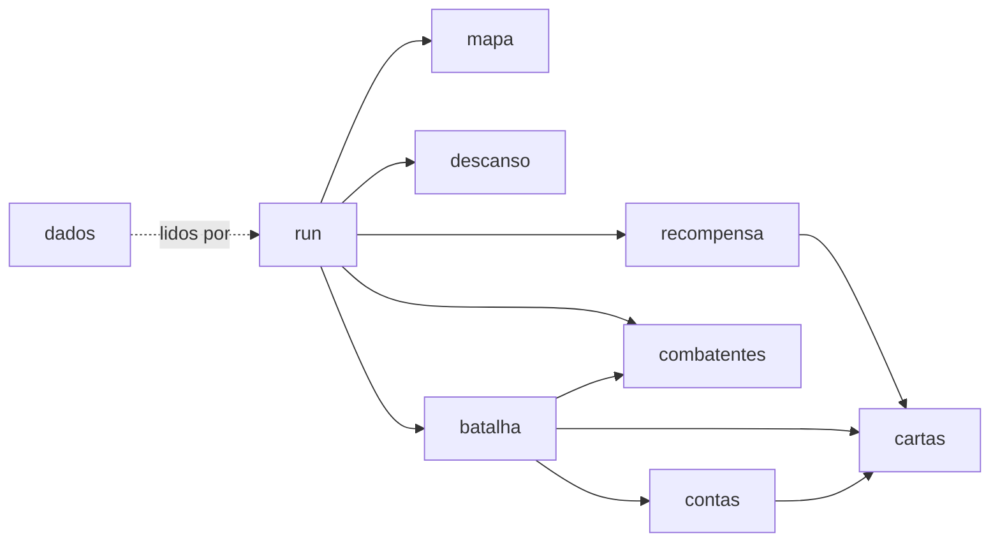
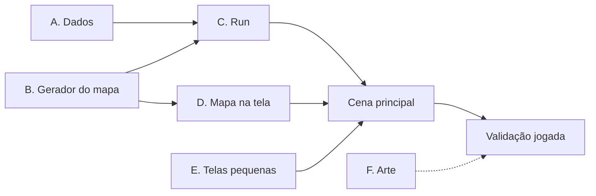

# Implementation Plan: Run e mapa

**Branch**: `main` (sem ramo próprio) | **Date**: 2026-11-18 | **Spec**: [spec.md](spec.md)

**Input**: Feature specification from `/specs/002-run-e-mapa/spec.md`

**Nota**: plano preenchido pelo comando `/speckit-plan`, que descreve o fluxo de trabalho.

## Summary

A luta da 001 vira parte de uma run: três atos (calabouço, salões, torre), cada um com um mapa
de andares gerado a cada run; casas de batalha, elite, descanso, recompensa e chefe; vida e
baralho que passam de uma casa para a outra; dificuldade que cresce com a profundidade, toda
num único arquivo de dados; e derrota que recomeça tudo do calabouço.

Abordagem técnica (detalhes e fontes em [research.md](research.md)):

- **A 001 entra pela interface dela.** A cena principal nova chama
  `tela_batalha.iniciar(cartas, vida_arthur, dados_inimigo, regras, semente)` e recebe
  `luta_terminou(resultado)`. Nenhum script de jogo da 001 muda; a luta avulsa deixa de ser a
  cena principal e fica como cena de teste (F6) (D1).
- **Run sem cena.** Todo o estado e as regras da run ficam na classe `Run` (`RefCounted`), com
  as etapas num `enum`: a run inteira roda e é testada sem tela (D2).
- **Mapa em camadas, gerado com semente.** Um `RandomNumberGenerator` por mapa, com a semente
  vinda da run; tamanho dos andares, tipos e ligações "em escada", que nunca se cruzam e deixam
  toda casa alcançável. Testado com 1.000 sementes por ato (D3, D4).
- **Um arquivo de dificuldade.** `dados/dificuldade.tres`, com os três atos, os inimigos e o
  tamanho do mapa dentro dele como sub-recursos; conferido antes de cada run, com a frase do
  valor errado na tela (D5, D6, D7).
- **Cena principal como raiz de composição.** Ela abre e fecha a cena de cada casa (luta,
  descanso, recompensa) e as telas de vitória e de fim de run, todas pequenas e avisando por
  sinal (D8, D10).
- **Chefe com ponto de troca.** Etapa `CHEFE` própria e a função `_abrir_chefe()`, que hoje abre
  uma luta comum mais forte e na 003 abre a prova (D11).
- **Pixel art e placeholders como na 001.** 640×360, escala inteira; mapa com posições
  calculadas e linhas desenhadas; nenhum asset criado (D9, D13).

## Technical Context

**Language/Version**: GDScript com tipagem estática, Godot 4.7.2-stable

**Primary Dependencies**: nenhuma em tempo de jogo; GUT 9.7.1 (`addons/gut/`) só para testes;
a 001 (batalha, cartas, contas, combatentes) usada pela interface pública

**Storage**: arquivos `.tres` somente leitura em `dados/` (o novo `dificuldade.tres` e as cartas
6 a 10); nada é salvo em disco (spec: nada fica entre runs)

**Testing**: GUT 9.7.1 pela linha de comando, em modo headless (comando no
[quickstart.md](quickstart.md))

**Target Platform**: PC (Windows e Linux), mouse; renderizador Compatibility

**Project Type**: jogo 2D para desktop (projeto Godot único)

**Performance Goals**: 60 fps; geração dos três mapas instantânea (poucas dezenas de casas);
busca do alvo da 001 com média abaixo de 10 ms nas faixas dos atos 2 e 3 e pior caso de cerca de
0,1 s, raro (research D7, **medido**)

**Constraints**: resolução base 640×360 com escala inteira; nenhum asset criado; código, dados e
textos em português; a mesma semente reproduz a run inteira; a 001 não é reescrita

**Scale/Scope**: 1 cena principal + 6 cenas pequenas novas; 7 classes novas de lógica e dados;
1 arquivo de dificuldade e 5 cartas novas; uma run tem 3 atos de 5 andares (13 a 15 lutas)

## Constitution Check

*Portão: precisa passar antes da pesquisa (fase 0) e ser conferido de novo depois do desenho
(fase 1).*

Constituição v1.0.1 (`.specify/memory/constitution.md`).

| Princípio | Como o plano atende | Situação |
|---|---|---|
| **I. Código Limpo e Minimalista** | Uma classe de lógica por responsabilidade (`Run`, `GeradorMapa`, `MapaAto`, `Casa`) e quatro de dados pequenas. Etapas da run num `enum` com `match`, sem classes de estado. Sem campos de textura para arte que ainda não existe. A única extração de código da 001 (o jogador automático dos testes) existe para não duplicar. A luta avulsa continua com testes e uso documentado (cena de teste); não é código morto. Nada da 003 ou da 004 é implementado. | passa |
| **II. Testes Reais (inegociável)** | Cada pasta nova tem `testes/`. Mapa conferido em 1.000 sementes por ato com verificações independentes do algoritmo (busca em largura, contagem de caminhos, cruzamentos). `Run` testada transição por transição e em 1.000 runs com a `Batalha` real da 001; 20 runs com lutas jogadas de verdade. Cada cena testada pelos seus sinais. Sem mocks: o resultado de luta nas 1.000 runs é dado de entrada da `Run` sob teste, e a luta tem a própria simulação na 001 (research D12). | passa |
| **III. Cenas Pequenas e Separadas** | Sete cenas novas (a principal e seis pequenas), cada uma com um papel, recebendo dados por método e avisando por sinal; só a principal conhece as outras. Pastas por área (`mapa/`, `run/`, `descanso/`, `recompensa/`), com cena, script e testes juntos. | passa |
| **IV. Assets Vêm da Equipe (inegociável)** | Só `ColorRect`, `Button`, `Label`, linhas do `_draw()` e a fonte padrão. Lista da 002 em `docs/assets-pendentes.md` (itens 24 a 34), com tamanho, quadros, formato e uso. | passa |
| **V. Tudo em Português** | Classes, arquivos, sinais, campos, comentários e textos em português, sem acento nos identificadores. Ficam em inglês os nomes do Godot e do GUT e os títulos do modelo do Spec Kit, como na 001 (notas do plano da 001). A palavra "run" é o termo da visão e da spec (ver nota abaixo). | passa, com as exceções justificadas |
| **Restrições Técnicas** | Godot 4.7.2-stable, GDScript tipado, GUT 9.7.1, como na 001; nenhuma dependência nova. | passa |
| **Fluxo de Desenvolvimento** | specify e dois clarify feitos (13/11 e 18/11); este plano confere os cinco princípios; tasks, analyze e implement vêm a seguir. A implementação só começa com a 001 fechada (T035 jogado e converge sem pendência), como pede o roteiro. | passa |

**Nota sobre "run" (princípio V)**: a visão do jogo e a spec usam "run" como palavra do jogo em
português (a "run", uma "run nova"), como os jogos do gênero. A classe `Run` e a pasta `run/`
usam a mesma palavra para o código bater com a spec, que é o que a equipe lê e defende. Não é
nome de API nem acento; fica registrado para o `/speckit-analyze`.

**Notas da 001 que continuam valendo**: as funções de teste começam com `test_` e os scripts
estendem `GutTest` (exigência do GUT); os títulos e campos fixos dos modelos do Spec Kit ficam
em inglês porque os comandos `/speckit-*` procuram as seções pelo nome.

**Reavaliação depois do desenho (Fase 1)**: sem mudanças. O modelo de dados e os contratos não
acrescentaram abstração além da descrita: a conferência dos dados (`erros()`) é exigida pela
FR-028, e o ponto de troca do chefe é uma função de duas linhas. As exceções continuam só as de
nomes do princípio V.

## Project Structure

### Documentation (this feature)

```text
specs/002-run-e-mapa/
├── plan.md              # este arquivo
├── research.md          # decisões técnicas, com a documentação do Godot 4.7 e as medições
├── data-model.md        # classes de dados e de lógica, valores padrão, etapas da run
├── quickstart.md        # como rodar os testes e validar jogando
├── contracts/
│   ├── run.md           # a Run, a cena principal e o ponto de troca do chefe (003)
│   └── telas-run.md     # cada cena pequena da run e a disposição da tela
├── checklists/
│   └── requirements.md
└── tasks.md             # criado pelo /speckit-tasks
```

Fora da pasta da funcionalidade: `docs/assets-pendentes.md` (seção da 002) e a seção
"Funcionalidade atual" do `CLAUDE.md`.

### Source Code (repository root)

Só o que é novo ou muda; o resto é a estrutura da 001.

```text
project.godot                 # MUDA: main_scene = res://run/tela_run.tscn
.gutconfig.json               # MUDA: + mapa/testes, run/testes, descanso/testes, recompensa/testes

dados/
├── cartas/
│   └── numero_6.tres … numero_10.tres     # NOVOS: cartas do conjunto de recompensas
└── dificuldade.tres                       # NOVO: o arquivo único de equilíbrio da run

mapa/                         # NOVA área: o mapa de um ato
├── dados_mapa.gd             # Resource: tamanho do mapa e casas de cada tipo
├── casa.gd                   # uma casa (tipo, andar, índice, ligações, visitada)
├── mapa_ato.gd               # as casas de um ato e as casas disponíveis
├── gerador_mapa.gd           # gera o mapa com uma semente (research D4)
├── casa_mapa.tscn / casa_mapa.gd       # uma casa na tela
├── tela_mapa.tscn / tela_mapa.gd       # o mapa inteiro, com as ligações
└── testes/
    ├── teste_dados_mapa.gd       # cada frase de erros()
    ├── teste_mapa_ato.gd         # casas do andar, chefe, disponíveis
    ├── teste_gerador_mapa.gd     # 1.000 sementes por ato (SC-001), mesma semente (SC-002)
    ├── teste_casa_mapa.gd
    └── teste_tela_mapa.gd        # só disponíveis clicáveis; x cresce com o índice

run/                          # NOVA área: a run e a cena principal
├── dados_ato.gd              # Resource: um ato (faixa, inimigos, mapa)
├── dados_dificuldade.gd      # Resource: o arquivo único
├── run.gd                    # estado e etapas da run (sem cena)
├── tela_run.tscn / tela_run.gd         # cena principal
├── vitoria_luta.tscn / vitoria_luta.gd # aviso depois de luta vencida
├── fim_de_run.tscn / fim_de_run.gd     # vitória ou derrota da run
└── testes/
    ├── teste_dados_ato.gd        # inimigo por andar, regras da luta, erros()
    ├── teste_dados_dificuldade.gd  # erros(); arquivo padrão válido; SC-004
    ├── teste_run.gd              # cada transição, vida, baralho, cura, oferta, atos
    ├── teste_simulacao_run.gd    # 1.000 runs (SC-003) e 20 runs com lutas de verdade
    ├── teste_vitoria_luta.gd
    ├── teste_fim_de_run.gd
    └── teste_tela_run.gd         # o fluxo pela cena principal

descanso/                     # NOVA área
├── tela_descanso.tscn / tela_descanso.gd
└── testes/teste_tela_descanso.gd

recompensa/                   # NOVA área
├── tela_recompensa.tscn / tela_recompensa.gd   # usa cartas/carta.tscn da 001
└── testes/teste_tela_recompensa.gd

batalha/testes/
├── jogador_automatico.gd     # NOVO: extraído de teste_simulacao.gd (research D1)
└── teste_simulacao.gd        # MUDA: usa o jogador automático extraído
cartas/testes/
└── teste_arquivos_cartas.gd  # MUDA: + 5 linhas (números 6 a 10)
luta_avulsa/
└── luta_avulsa.gd            # MUDA: só o comentário do topo (deixa de ser a cena principal)
```

**Structure Decision**: o mesmo projeto Godot único, organizado **por área do jogo**, da 001
(princípio III). Quatro áreas novas, cada uma com cena, script e `testes/`. Os dados de
equilíbrio continuam todos em `dados/`. `DadosMapa` fica em `mapa/` (é o que o gerador lê) e
`DadosAto`/`DadosDificuldade` em `run/`, para o mapa não depender da run.

Dependências entre as áreas (uma seta = "usa"):



`mapa`, `descanso` e `recompensa` não dependem de `run`: recebem só `MapaAto`, números ou
cartas. Só a área `run` conhece todas as outras, e só pela interface pública delas.

## Ordem de construção

Para o `/speckit-tasks` detalhar. Cada passo termina com os testes da área passando e commit.
Antes do passo 1, a 001 precisa estar fechada (T035 jogado e converge sem pendência).

1. **Base**: `.gutconfig.json` com as pastas novas; cartas 6 a 10 e a tabela do teste de
   cartas; jogador automático extraído (a simulação da 001 continua passando).
2. **Dados**: `DadosMapa`, `DadosAto` e `DadosDificuldade` com `erros()` e testes de cada regra;
   `dados/dificuldade.tres` e a conferência dos dados padrão (SC-004).
3. **Mapa (lógica)**: `Casa`, `MapaAto`, `GeradorMapa` e o teste de 1.000 sementes por ato.
4. **Run (lógica)**: `Run` com as etapas, transição por transição; depois a simulação de 1.000
   runs e as 20 runs com lutas de verdade. Aqui as quatro histórias já estão provadas sem tela.
5. **Cenas pequenas**: `casa_mapa`, `tela_mapa`, `tela_descanso`, `tela_recompensa`,
   `vitoria_luta`, `fim_de_run`, cada uma com o seu teste.
6. **Cena principal**: `tela_run` com a barra, o aviso de dados errados e o fluxo das etapas;
   `project.godot` com a cena principal nova; comentário da `luta_avulsa` e quickstart da 001.
7. **Validação**: quickstart da 002 (a parte do Claude e a jogada) e conferência de
   `docs/assets-pendentes.md`.

Como na 001, o `tasks.md` pode reorganizar os passos 4 a 6 por história (a lógica e as cenas de
cada história juntas), para a história 1 (P1) ser entregue e jogada primeiro.

## Trabalho em paralelo pela equipe de 6

Os contratos ([contracts/](contracts/)) e o [data-model.md](data-model.md) fixam as interfaces
antes do código, então cada frente pode começar com objetos montados à mão nos próprios testes,
sem esperar a outra terminar. Seis frentes, uma por pessoa (quem fica com cada uma é decisão da
equipe):

| Frente | O que faz | Pastas e arquivos | Pode começar | Depende de |
|---|---|---|---|---|
| A. Dados | `DadosAto`, `DadosDificuldade`, `erros()`, `dificuldade.tres`, cartas 6 a 10, teste SC-004 | `run/dados_*.gd`, `dados/` | já, pelas cartas 6 a 10; `DadosAto` depois de `Casa` e `DadosMapa` | `Casa.Tipo` e `DadosMapa` da frente B |
| B. Gerador do mapa | `DadosMapa`, `Casa`, `MapaAto`, `GeradorMapa`, teste de 1.000 sementes | `mapa/` (lógica) | já | nada |
| C. Run | `Run`, etapas, simulações | `run/run.gd`, `run/testes/` | já, com dados de teste montados à mão | interfaces de A e B (data-model); junta com elas no fim |
| D. Mapa na tela | `casa_mapa`, `tela_mapa`, ligações e marcador | `mapa/` (cenas) | já, com `MapaAto` montado à mão | `Casa` e `MapaAto` de B (só os campos) |
| E. Telas pequenas | `tela_descanso`, `tela_recompensa`, `vitoria_luta`, `fim_de_run` | `descanso/`, `recompensa/`, `run/` (cenas) | já | `fim_de_run` lê a `Run` (C); as outras só números e cartas |
| F. Arte e validação | procurar os assets 24 a 34 com licença; depois jogar o quickstart e cronometrar a run | `docs/assets-pendentes.md` | já | o jogo montado (passo 6) para jogar |

A cena principal (`tela_run`, passo 6) junta tudo e fica com quem fez a frente C, depois que A a
E estão no `main`. Para não dar conflito de merge: cada frente mexe só nas próprias pastas; os
arquivos compartilhados (`.gutconfig.json`, `project.godot`, `docs/assets-pendentes.md`) mudam
em commits pequenos e separados.



No roteiro do projeto (`docs/roteiro-speckit.md`) a 002 é implementada pelo Claude em 20/11;
nesse caso a ordem de construção acima vale como está, e a tabela serve para dividir a
validação, a revisão dos commits e a busca de assets.

## Decisões que mudaram a spec neste plano

- **Faixa de alvo do ato 3 fora de alcance no começo** (Estêvão, 18/11): com o baralho inicial,
  a mão do começo da luta chega no máximo a 10, abaixo da faixa padrão do ato 3 (12 a 24). É
  esperado: são as cartas ganhas na run que tornam as faixas maiores alcançáveis. Os valores
  padrão ficam. Registrado em "Clarifications" da spec e no research (D7).

## Complexity Tracking

Nenhuma violação da constituição a justificar. As exceções de nomes do princípio V estão
justificadas no Constitution Check e não acrescentam complexidade ao código.
