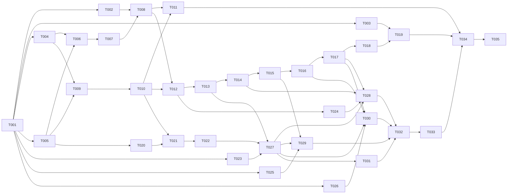

---

description: "Lista de tarefas da funcionalidade 002, run e mapa"
---

# Tasks: Run e mapa

**Input**: documentos de `specs/002-run-e-mapa/` ([plan.md](plan.md), [spec.md](spec.md),
[research.md](research.md), [data-model.md](data-model.md), [contracts/](contracts/),
[quickstart.md](quickstart.md))

**Prerequisites**: a 001 fechada antes do T001 (T035 da 001 jogado e o `/speckit-converge` da
001 sem pendência), como pedem o plano e o `CLAUDE.md`.

**Tests**: obrigatórios (constituição, princípio II). Cada tarefa escreve os testes **junto**
com o código que eles testam, no mesmo commit. As exceções são as tarefas só de testes (T011,
T018 e T019), que conferem código já feito em outra tarefa; se um desses testes falhar, a
correção entra no mesmo commit e o teste que falhou fica como o teste do defeito (princípio II,
"bug corrigido ganha teste").

**Organization**: as fases seguem a "Ordem de construção" do plano, passo a passo (fase 1 =
passo 1; fase 2 = passos 2 e 3; fase 3 = passo 4; fase 4 = passo 5; fase 5 = passo 6; fase 6 =
passo 7). Dentro de cada fase as tarefas estão agrupadas por área do jogo (mapa, run, descanso,
recompensa, cartas, batalha). As fases 3 a 5 levam o rótulo da história da spec que cada tarefa
atende (`[US1]` a `[US4]`), e dentro delas as tarefas vêm na ordem das histórias, para a cena
principal ir ganhando uma história por commit.

## Regras para toda tarefa

- **Uma tarefa = um commit**, em português, terminando com a suíte inteira passando:
  `godot --headless --path . --import` (quando criar classe, cena ou `.tres`) e
  `godot --headless --path . -s addons/gut/gut_cmdln.gd` (ver [quickstart.md](quickstart.md)).
  Versionar junto o `.uid` que o Godot gerar para cada script novo (falha do T032 da 001).
- Os testes da tarefa ficam em `<área>/testes/teste_<assunto>.gd`, estendem `GutTest` e as
  funções começam com `test_`; o resto do nome em português.
- Testes reais: criar os objetos de verdade e conferir o comportamento. Proibido
  `assert_true(true)`, teste que só confere mock ou teste ajustado para esconder defeito.
- GDScript com tipagem estática; identificadores sem acento, em `snake_case`; classes em
  `PascalCase`; textos do jogo em português com acento.
- **Nenhum número de equilíbrio solto no código**: tudo vem de `dados/dificuldade.tres` (pelas
  classes `DadosDificuldade`, `DadosAto`, `DadosMapa`) ou da `RegrasBatalha` da 001 (FR-027).
  Posições e cores das cenas vêm dos contratos e não são equilíbrio.
- **Sorteio** (research D3): todo sorteio usa um `RandomNumberGenerator` com semente vinda de
  fora; sorteio sem repetição é `lista.pop_at(rng.randi_range(0, lista.size() - 1))`. Proibidos
  `shuffle()`, `pick_random()`, `randi()` e `randf()` soltos; a única exceção é o `randi()` da
  semente de cada run nova em `run/tela_run.gd`. Nos testes com muitas sementes, a semente do
  caso `i` é `hash(i)`.
- **A 001 não muda**: nenhum script de jogo de `batalha/`, `cartas/`, `contas/` ou
  `combatentes/` é alterado. O que muda fora das pastas novas está na tabela do research D1, e
  cada mudança dessas tem a sua tarefa.
- **Dados só leitura**: a `Run` nunca escreve nos objetos de `dificuldade` (research D5); os
  testes que mudam um valor usam uma cópia (`duplicate(true)`) e conferem que o arquivo
  carregado ficou igual. O `duplicate(true)` copia o que está dentro de `dificuldade.tres`
  (atos, inimigos, mapas), mas não os arquivos apontados por ele (`regras_base` e as cartas):
  o teste que muda algo em `regras_base` copia também ela, com
  `copia.regras_base = copia.regras_base.duplicate()` (research D12, **medido**).
- Nenhuma imagem, som ou fonte é criado (princípio IV). Os placeholders da 002 já estão em
  `docs/assets-pendentes.md` (itens 24 a 34); se a cena feita pela tarefa mudar um placeholder,
  a linha muda no mesmo commit.
- **GodotPrompter** (`CLAUDE.md`): antes de cada tarefa, carregar a skill da área e dizer o
  padrão escolhido e o descartado. Testes: `godot-testing`; dados: `resource-pattern`;
  gerador do mapa: `procedural-generation`; `Run`: `state-machine`; cenas: `godot-ui` e
  `scene-organization`; código em geral: `gdscript-patterns`.
- Antes de dar a tarefa como concluída (constituição, "Fluxo de Desenvolvimento"): rodar a
  suíte inteira, conferir que não sobrou código morto ou comentado (função, variável, sinal,
  nó ou arquivo que ninguém usa, `print` de depuração) e listar, no relato da tarefa, os
  assets pedidos que continuam pendentes.

## Format: `[ID] [P?] [Story] Description`

- **[P]**: pode ser feita em paralelo por outra pessoa da equipe (arquivos diferentes, sem
  depender de tarefa ainda aberta)
- **[Story]**: história da spec atendida (US1 a US4)

---

## Phase 1: Setup (passo 1 do plano: base)

**Purpose**: suíte enxergando as pastas novas, cartas do conjunto de recompensas e o jogador
automático da 001 pronto para ser usado pela simulação da run.

- [ ] T001 Acrescentar a `.gutconfig.json`, em `dirs`, `"res://mapa/testes"`, `"res://run/testes"`, `"res://descanso/testes"` e `"res://recompensa/testes"`; criar as quatro pastas com um `.gitkeep` cada (que sai no commit que cria o primeiro teste da pasta) e conferir que a suíte roda sem erro de carregamento e com o mesmo número de testes de antes (research D1)
- [ ] T002 [P] Criar `dados/cartas/numero_6.tres` a `numero_10.tres` (`tipo` NUMERO, `valor` 6 a 10, `ataque` 3, 4, 4, 5, 6, sem efeito; mesmo formato de `numero_5.tres`) e acrescentar as 5 linhas na tabela de `cartas/testes/teste_arquivos_cartas.gd` (o teste "pasta tem só as cartas da tabela" exige as duas coisas no mesmo commit); o baralho da luta avulsa continua com as 21 cartas (data-model, "Cartas novas")
- [ ] T003 [P] Extrair o jogador automático de `batalha/testes/teste_simulacao.gd` para `batalha/testes/jogador_automatico.gd` (sem o prefixo `teste_`, para o GUT não rodá-lo como teste; `extends RefCounted`, carregado com `preload` pelos testes, sem `class_name`, para código de teste não virar classe global): o `enum Acao`, o `CICLO`, a jogada de uma rodada (acertar com a conta de exemplo da `BuscaAlvo` recebida, errar com `_carta_errada`, pular), `_montar` e as funções de apoio `usa_so_a_mao`, `quantos_do_tipo` e `simbolos`; a `BuscaAlvo` passa a ser recebida (na 002 a faixa muda por ato); `teste_simulacao.gd` passa a usar o jogador extraído e mantém as próprias conferências; conferir que os dois testes da simulação da 001 continuam passando com as mesmas contagens (research D1, D12)

**Checkpoint**: suíte inteira passando com as pastas novas, 21 cartas de dados e a simulação da
001 igual.

---

## Phase 2: Foundational (passos 2 e 3 do plano: dados e mapa sem tela)

**Purpose**: os dados de equilíbrio conferidos e o mapa gerado e testado, sem nenhuma cena.
Tudo que a `Run` e as cenas usam.

**⚠️ CRITICAL**: a `Run` (fase 3) espera esta fase inteira. O T020 só precisa do T005; o T021
precisa também do T010.

**Desvio pequeno da ordem do plano**: a `Casa` (passo 3) entra antes de `DadosAto` (passo 2)
porque `DadosAto.inimigo()` recebe um `Casa.Tipo`.

### Área: mapa (dados e casas)

- [ ] T004 [P] Criar `DadosMapa` em `mapa/dados_mapa.gd` (`class_name DadosMapa extends Resource`) com os 8 campos `@export` e os padrões da tabela do [data-model.md](data-model.md) (4, 2, 3, 3, 3, 1, 2, 2), `casas_acima_do_primeiro() -> int` e `erros() -> Array[String]` com as 9 regras na ordem do data-model (as regras 7 a 9 só são conferidas se as de 1 a 6 passaram), cada frase citando o nome do campo e o valor lido; testes em `mapa/testes/teste_dados_mapa.gd`: `DadosMapa.new()` sem erros e com `casas_acima_do_primeiro()` 8; um teste por regra, quebrando só aquele valor e conferindo que sai uma frase com o nome do campo (FR-028: "mapa sem andares" com `andares_comuns = 1`, "mais casas de um tipo do que o ato comporta" com `descansos = 10`, "ato sem casa de descanso" com `descansos = 0`, "elite sem andar acima do 2" com `andares_comuns = 2` e `elites = 1`); o caso da regra 9 (elite sem vaga com o andar 2 cheio) com valores que passam nas regras 1 a 8; regra 1 quebrada não gera as frases de 7 a 9; remover `mapa/testes/.gitkeep`
- [ ] T005 [P] Criar `Casa` em `mapa/casa.gd` (`class_name Casa extends RefCounted`, `enum Tipo { BATALHA, ELITE, DESCANSO, RECOMPENSA, CHEFE }`, campos `tipo`, `andar`, `indice`, `ligacoes: Array[Casa]`, `visitada`) e `MapaAto` em `mapa/mapa_ato.gd` (`class_name MapaAto extends RefCounted`, `casas: Array[Casa]`, `total_de_andares`, `casas_do_andar(andar)`, `chefe()`, `disponiveis(atual)`), conforme o [data-model.md](data-model.md); testes em `mapa/testes/teste_mapa_ato.gd` com um mapa montado à mão (3, 2 e 1 casas): `casas_do_andar` em ordem de `indice`, `chefe()` é a casa única do topo, `disponiveis(null)` são as casas do andar 1, `disponiveis(casa)` são as `ligacoes` dela, andar inexistente devolve lista vazia

### Área: run (dados)

- [ ] T006 Criar `DadosAto` em `run/dados_ato.gd` (`class_name DadosAto extends Resource`) com os campos `@export` do [data-model.md](data-model.md) (`nome`, `alvo_minimo`, `alvo_maximo`, `comum`, `elite`, `chefe`, `vida_extra_por_andar`, `mapa`), `inimigo(tipo, andar) -> DadosInimigo` (sempre um `DadosInimigo.new()`; batalha e elite com vida + `vida_extra_por_andar × (andar − 1)`; chefe sem acréscimo; descanso e recompensa `null`), `regras_da_luta(base) -> RegrasBatalha` (`base.duplicate()` com a faixa do ato) e `erros()`; testes em `run/testes/teste_dados_ato.gd` com um ato montado à mão com os números do ato 1: `inimigo(BATALHA, 3)` tem 14 de vida e 3 de ataque, `inimigo(ELITE, 4)` 21 e 4, `inimigo(CHEFE, 5)` 26 e 5, descanso e recompensa `null`; mudar o inimigo devolvido não muda `comum`; `regras_da_luta` com faixa 5 a 12 e a base intacta; uma frase de `erros()` para cada regra (faixa invertida com a frase do contrato, "Ato 1 (Calabouço): alvo_minimo (13) é maior que alvo_maximo (12)." montada pelo `DadosDificuldade`; vida ou ataque menor que 1 em cada um dos três inimigos; inimigo vazio; `vida_extra_por_andar` negativo; `mapa` vazio) e as frases do `mapa.erros()` repassadas; remover `run/testes/.gitkeep` (depende de T004, T005)
- [ ] T007 Criar `DadosDificuldade` em `run/dados_dificuldade.gd` (`class_name DadosDificuldade extends Resource`) com os campos `@export` do [data-model.md](data-model.md) (`regras_base`, `baralho_inicial`, `cartas_de_recompensa`, `cartas_por_recompensa`, `cura_do_descanso`, `atos`) e `erros()`, pondo "Ato N (nome): " na frente das frases de cada ato; testes em `run/testes/teste_dados_dificuldade.gd` com dados montados à mão: válidos sem erros; uma frase para cada regra (`regras_base` vazio; `atos` vazio ou com posição vazia; `baralho_inicial` sem carta de número ou com posição vazia, FR-028; `cartas_de_recompensa` com posição vazia; `cartas_por_recompensa` menor que 1; `cura_do_descanso` fora de 0 a 100); `cartas_de_recompensa` vazio **não** é erro; o prefixo "Ato 2 (Salões): " nas frases do segundo ato (depende de T006)
- [ ] T008 Criar `dados/dificuldade.tres` (tipo `DadosDificuldade`) com os valores padrão do [data-model.md](data-model.md): `regras_base` apontando `dados/regras_batalha.tres`, o baralho inicial de 13 cartas e as 14 cartas de recompensa apontando os arquivos de `dados/cartas/`, `cartas_por_recompensa` 3, `cura_do_descanso` 30 e os três `DadosAto` (Calabouço, Salões, Torre) com `DadosInimigo` e `DadosMapa` como sub-recursos do mesmo arquivo; testes em `run/testes/teste_dados_dificuldade.gd`: o arquivo carrega com `erros()` vazio, o baralho inicial é o da FR-002 (2 de cada número de 1 a 5, +, −, ×), as 14 cartas de recompensa são diferentes entre si, e a conferência SC-004 do data-model ("Conferência dos dados padrão") com `DadosAto.inimigo()` em todos os andares de todos os atos (nada diminui dentro do ato; faixa, vida e ataque crescem de um ato para o seguinte; o comum e a elite do andar 1 do ato seguinte não têm menos vida que os do último andar comum do anterior; elite mais forte que o comum do mesmo andar; chefe mais forte que a elite do último andar comum) (depende de T002, T007)

### Área: mapa (gerador)

- [ ] T009 [P] Criar `GeradorMapa` em `mapa/gerador_mapa.gd` (`class_name GeradorMapa`, só `static func gerar(dados: DadosMapa, semente: int) -> MapaAto`) com os passos 1 e 2 do research D4: um `RandomNumberGenerator` com a semente; andar 1 com `batalhas_primeiro_andar` batalhas; tamanho dos andares 2 em diante (cada um começa no mínimo e as casas que sobram vão uma a uma para um andar sorteado que ainda não chegou no máximo); tipos (um descanso numa vaga sorteada do último andar comum, cada elite numa vaga livre sorteada do andar 3 em diante, o resto nas vagas livres, uma a uma); chefe sozinho no topo; `indice` em ordem; as ligações ficam para o T010; testes em `mapa/testes/teste_gerador_mapa.gd`, 1.000 sementes `hash(i)` com `DadosMapa.new()` e com configurações válidas diferentes (2 andares comuns sem elite; 6 andares comuns; mínimo igual ao máximo): quantidade de cada tipo igual à dos dados, andar 1 só de batalhas, nenhuma elite no andar 2, pelo menos um descanso no último andar comum, chefe sozinho no topo, cada andar comum entre o mínimo e o máximo; com os padrões, só as divisões 3-3-2, 3-2-3 e 2-3-3 aparecem; mesma semente dá os mesmos tipos e andares (SC-002) e sementes diferentes dão mais de um mapa diferente (depende de T004, T005)
- [ ] T010 Acrescentar o passo 3 do research D4 em `mapa/gerador_mapa.gd`: ligações "em escada" entre andares vizinhos (caminho na grade `a × b` de (0, 0) a (a−1, b−1), sorteando a cada passo entre avançar em cima, embaixo ou nos dois; quando um lado já está no fim, só o outro avança), cada ligação em `ligacoes` em ordem de `indice`, e todas as casas do último andar comum ligadas ao chefe; testes em `mapa/testes/teste_gerador_mapa.gd`, com uma função de conferência que não usa o algoritmo, nas mesmas 1.000 sementes e configurações do T009: busca em largura do andar 1 alcança todas as casas; busca ao contrário a partir do chefe também; contagem de caminhos do andar 1 ao chefe (soma andar a andar) pelo menos 2; nenhum par de ligações entre os mesmos andares com `i1 < i2` e `j1 > j2`; ligações só para o andar seguinte, sem repetição; chefe sem ligações; mesma semente dá as mesmas ligações (depende de T009)
- [ ] T011 Conferir o SC-001 nos dados padrão: em `mapa/testes/teste_gerador_mapa.gd`, rodar a conferência completa do T009 e do T010 em 1.000 sementes para cada um dos três `mapa` de `dados/dificuldade.tres` (depende de T008, T010)

**Checkpoint**: dados conferidos (SC-004) e mapa garantido em 1.000 sementes por ato (SC-001,
SC-002), sem tela.

---

## Phase 3: Run sem tela (passo 4 do plano)

**Goal**: a `Run` inteira, transição por transição, e as simulações. No fim desta fase as
quatro histórias estão provadas sem tela.

**Independent Test**: os testes de `run/testes/teste_run.gd` e
`run/testes/teste_simulacao_run.gd` passando (`-gselect=run`).

Todas as tarefas desta fase mexem em `run/run.gd`, por isso são em sequência e de uma pessoa
só (frente C do plano). Os testes montam cenários pelos campos públicos da `Run` (por exemplo,
`vida_arthur = 20` e `casa_atual` numa casa do andar anterior ligada à casa desejada) e criam o
`ResultadoLuta` à mão (`venceu`, `vida_arthur`).

### Área: run (lógica)

- [ ] T012 [US1] Criar `Run` em `run/run.gd` (`class_name Run extends RefCounted`) com o `enum Etapa`, os campos e a assinatura do [contracts/run.md](contracts/run.md): `_init(dificuldade, semente)` com um `RandomNumberGenerator` da run que tira, nesta ordem, as sementes dos mapas e gera todos com `GeradorMapa.gerar()` (research D3), vida 40/40 vinda de `regras_base.vida_maxima_arthur`, baralho cópia de `baralho_inicial`, etapa `MAPA`; `mapa()`, `dados_do_ato()`, `ultimo_ato()`, `casas_disponiveis()` (pela `MapaAto.disponiveis()`; vazia fora do `MAPA`), `escolher_casa(casa)` para casas de batalha, elite e chefe (`casa_atual`, `visitada`, `semente_da_luta` sorteada, etapa `LUTA` ou `CHEFE`; casa fora das disponíveis ou etapa errada devolve `false` sem mudar nada; descanso e recompensa ficam para T015 e T016), `inimigo_da_luta()`, `regras_da_luta()`, `andar_alcancado()` e `terminou()`; testes em `run/testes/teste_run.gd` com `dados/dificuldade.tres`: história 1, cenário 1 (ato 1, 40/40, 13 cartas, só o andar 1 disponível); cenário 2 (casa não ligada, de andar abaixo ou dois acima: `false` e nada muda); cenário 3 (com `vida_arthur = 31` a luta recebe 31, e o inimigo e a faixa são os do `DadosAto` daquele andar); mudar `run.baralho` não muda o `baralho_inicial` do arquivo; mesma semente dá os mesmos três mapas e a mesma `semente_da_luta` (depende de T008, T010)
- [ ] T013 [US1] Acrescentar `terminar_luta(resultado)` em `run/run.gd` para a vitória numa batalha comum (`vida_arthur = resultado.vida_arthur`, `lutas_vencidas += 1`, etapa `MAPA`, sem oferta); fora de `LUTA` e `CHEFE` não faz nada; testes em `run/testes/teste_run.gd`: história 1, cenário 4 (vitória com 24: casa visitada, Arthur nela, vida 24, só as ligações dela disponíveis); uma subida do andar 1 ao 4 só por batalhas (escolhendo, em cada andar, uma batalha ligada à atual, posicionando a run quando o mapa sorteado não tiver) conferindo a invariante do data-model (as casas visitadas formam um caminho, uma por andar, cada uma ligada à seguinte) e que `vida_arthur` fica entre 1 e a máxima (depende de T012)
- [ ] T014 [US2] Acrescentar a derrota em `terminar_luta()` em `run/run.gd` (`vida_arthur = 0`, etapa `DERROTA`, `terminou()` verdadeiro; nenhum método muda nada depois); testes em `run/testes/teste_run.gd`: história 2, cenário 1 (run no ato 2 com 16 cartas no baralho perde: `DERROTA`, `ato`, `andar_alcancado()` e `lutas_vencidas` certos), cenário 2 no nível da lógica (outra `Run.new()` com outra semente tem mapa do ato 1 diferente, 40/40 e as 13 cartas iniciais), cenário 3 (derrota no chefe dá o mesmo resultado); `escolher_casa`, `sair_do_descanso` e `escolher_recompensa` não fazem nada em `DERROTA` (depende de T013)
- [ ] T015 [US3] Acrescentar o descanso em `run/run.gd`: `escolher_casa()` numa casa de descanso cura `floori(vida_maxima × cura_do_descanso / 100.0)` sem passar da máxima, guarda em `cura` quanto curou de fato e vai para `DESCANSO`; `sair_do_descanso()` volta ao `MAPA` (só vale em `DESCANSO`); testes em `run/testes/teste_run.gd`: história 3, cenários 1 (20 → 32, cura 12) e 7 (35 → 40, cura 5); vida cheia (cura 0); com uma cópia dos dados com `cura_do_descanso` 50, a cura é 20 e o arquivo carregado continua com 30 (SC-005) (depende de T014)
- [ ] T016 [US3] Acrescentar a recompensa em `run/run.gd`: `escolher_casa()` numa casa de recompensa sorteia a `oferta` e vai para `RECOMPENSA`; a vitória numa elite também sorteia e vai para `RECOMPENSA` (FR-022); `escolher_recompensa(carta)` põe a carta no fim do `baralho` (ou nada, com `null`), esvazia a `oferta` e volta ao `MAPA`; carta fora da oferta não faz nada; oferta pela regra do data-model (lista sem repetidas, sorteio sem repetição com o gerador da run, até `cartas_por_recompensa`); testes em `run/testes/teste_run.gd`: história 3, cenário 2 (3 cartas diferentes entre si, todas do conjunto), cenário 3 (escolher a Chama: baralho com 14 e a Chama no fim), cenário 4 (`null`: baralho igual), cenário 5 (elite vencida abre a recompensa) e cenário 6 (batalha vencida não abre); conjunto com a mesma carta duas vezes conta uma; conjunto de 2 cartas dá oferta de 2; conjunto vazio dá oferta vazia e `escolher_recompensa(null)` volta ao mapa; a invariante "baralho = inicial + escolhidas, na ordem"; mesma semente dá as mesmas ofertas (depende de T015)
- [ ] T017 [US4] Acrescentar o chefe e a troca de ato em `run/run.gd`: vitória no chefe de um ato que não é o último sorteia a oferta e vai para `RECOMPENSA`, e `escolher_recompensa()` com a casa atual sendo o chefe faz `ato += 1` e `casa_atual = null` (FR-023); vitória no chefe do último ato vai para `VITORIA`, sem oferta (FR-022, FR-024); testes em `run/testes/teste_run.gd`: história 4, cenário 1 (chefe do ato 1 vencido com 18 de vida e 15 cartas; depois da recompensa sem pegar carta, ato 2, 18 de vida, 15 cartas, só o andar 1 do mapa do ato 2 disponível), cenário 2 (inimigo e faixa do andar 1 do ato 3 maiores que os do andar 1 do ato 1), cenário 3 (cópia dos dados com o comum do ato 1 com 20 de vida: o inimigo da batalha do andar 1 tem 20), cenário 4 (chefe do ato 3 vencido: `VITORIA`, oferta vazia, `terminou()`); `inimigo_da_luta()` no chefe é o `chefe` do ato; SC-002: duas runs com a mesma semente e a mesma sequência de chamadas, do ato 1 à vitória, têm os mesmos mapas, sementes de luta e ofertas (depende de T016)
- [ ] T018 [US4] Criar `run/testes/teste_simulacao_run.gd` com 1.000 runs de escolhas automáticas (SC-003), sementes `hash(i)` e um gerador do teste para as escolhas: em cada casa de luta ou chefe, criar a `Batalha` real da 001 com o que a `Run` entrega (`baralho`, `vida_arthur`, `inimigo_da_luta()`, `regras_da_luta()`, `semente_da_luta`), sem chamar `iniciar()` (não precisa da busca do alvo, e o teste fica rápido), e conferir que `batalha.arthur.vida` é a vida que sobrou da casa anterior somada à cura do descanso, se houve, que as cartas de `batalha.baralho.compra` (antes de `iniciar()` estão todas lá) são o baralho inicial mais as escolhidas até ali (mesma contagem de cada carta), e que `batalha.arthur.escudo` é 0 e `batalha.baralho.mao` está vazia (FR-005); o resultado da luta é sorteado pelo teste (vitória com vida entre 1 e a atual, ou derrota com chance baixa, para muitas runs chegarem ao ato 3); na recompensa, escolher uma carta da oferta ou nenhuma; conferir em toda casa as invariantes do data-model; as falhas são contadas e conferidas no fim, como na simulação da 001; conferir que houve runs terminando em `VITORIA` e em `DERROTA` (depende de T017)
- [ ] T019 [US4] Acrescentar em `run/testes/teste_simulacao_run.gd` 20 runs com lutas jogadas de verdade pelo jogador automático (`batalha/testes/jogador_automatico.gd`, T003), do ato 1 até a vitória ou a derrota, com a `BuscaAlvo` montada com a faixa de cada luta: em toda rodada, o alvo tem conta de exemplo que usa só cartas da mão e a mão tem o mínimo quando o baralho permite (FR-029); a vida levada para a `Run` é a do `ResultadoLuta` (que não tem baralho: `venceu`, `vida_arthur`, `vida_inimigo`, `rodadas`), e `run.baralho` continua igual depois de cada luta jogada (FR-004: jogar cartas não tira cartas do baralho da run); a mesma semente com as mesmas escolhas repete a run inteira, rodada por rodada (SC-002); sem exigir "nenhuma busca no teto" (research D7) (depende de T003, T018)

**Checkpoint**: as quatro histórias provadas sem tela. A `Run` está pronta para a cena
principal.

---

## Phase 4: Cenas pequenas (passo 5 do plano)

**Goal**: cada cena da run abre e funciona sozinha, recebendo dados por método e avisando por
sinal ([contracts/telas-run.md](contracts/telas-run.md)).

**Independent Test**: os testes de cena de cada área passando; cada cena pode ser aberta com F6
depois de chamar o seu `mostrar()` num teste.

Os testes de cena seguem a 001 (research D12): instanciar a cena, pôr na árvore com
`add_child_autofree()`, chamar o método de entrada, acionar os botões e conferir textos e
sinais (`watch_signals`). As tarefas desta fase podem começar logo depois das tarefas de que
dependem, em paralelo com a fase 3 (frentes D e E do plano).

### Área: mapa (tela)

- [ ] T020 [P] [US1] Criar `mapa/casa_mapa.tscn` (raiz `Button` 32×32 com `ColorRect` 32×32 e `Label` da letra) com `mapa/casa_mapa.gd`: sinal `escolhida` e `mostrar(tipo, disponivel)` com a letra, a cor e o `tooltip_text` da tabela do contrato e os estados (disponível: `disabled = false`, cor cheia e moldura clara de 1 px; não disponível, visitada ou não: `disabled = true`, `modulate` 0,5; a casa não recebe se foi visitada, o caminho percorrido é desenhado pela `tela_mapa` no T022), com o `ColorRect` e a moldura (se ela for um nó) em `mouse_filter = MOUSE_FILTER_IGNORE`, para o clique e a dica chegarem ao `Button` (research D9); testes em `mapa/testes/teste_casa_mapa.gd`: letra, cor e dica de cada um dos 5 tipos; disponível emite `escolhida` ao pressionar; não disponível não emite; `ColorRect` e moldura com `mouse_filter` `IGNORE` (o `STOP` padrão do `ColorRect` engoliria o clique, e o pressionar do teste não perceberia) (depende de T005)
- [ ] T021 [US1] Criar `mapa/tela_mapa.tscn` (raiz `Control` 640×360) com `mapa/tela_mapa.gd` (`class_name TelaMapa`): sinal `casa_escolhida(casa)`, `static func posicao_da_casa(andar, indice, casas_no_andar, total_de_andares) -> Vector2` com a disposição do contrato (chefe em `y = 48`, andar 1 em `y = 312`, andares no meio divididos por igual, casas centradas em `x = 320` a cada 96 px, valores arredondados) e `mostrar(mapa, casa_atual)`, que recria uma `casa_mapa` por casa no centro calculado, com só as de `mapa.disponiveis(casa_atual)` clicáveis, e repassa o clique como `casa_escolhida(casa)`; testes em `mapa/testes/teste_tela_mapa.gd`: posições do contrato para 5 andares (224, 320, 416 com 3 casas; 272, 368 com 2; y 48 e 312); em mapas de `GeradorMapa.gerar()` com várias sementes, o `x` cresce com o `indice` em todo andar; com `casa_atual` nula só as do andar 1 clicáveis; clicar numa disponível emite `casa_escolhida` com aquela casa; clicar numa não disponível não emite; um segundo `mostrar()` não deixa casas sobrando (depende de T010, T020)
- [ ] T022 [US1] Acrescentar em `mapa/tela_mapa.gd` as ligações no `_draw()` (`draw_line` entre os centros de `posicao_da_casa`, largura 2, sem suavização, por baixo das casas, com as cores do contrato: cinza comum, branca quando as duas casas foram visitadas, amarela da casa atual para uma disponível; `queue_redraw()` a cada `mostrar()`) e o marcador do Arthur (`ColorRect` 8×8, `Color(0.25, 0.4, 0.8)`, `mouse_filter = MOUSE_FILTER_IGNORE`, em `x = 320`, `y = 344` antes do andar 1, ou no canto de cima e da esquerda da casa atual); separar numa função pura a escolha da cor de cada ligação, para o teste não depender do desenho; testes em `mapa/testes/teste_tela_mapa.gd`: cor de cada tipo de ligação num mapa montado à mão com caminho percorrido; posição do marcador antes do andar 1 e numa casa; marcador com `mouse_filter` `IGNORE`; conferir as cores e tamanhos com as linhas 28 e 29 de `docs/assets-pendentes.md` (depende de T021)

### Área: run (telas)

- [ ] T023 [P] [US1] Criar `run/vitoria_luta.tscn` (raiz `Control` tela inteira, `CenterContainer` com `VBoxContainer`) com `run/vitoria_luta.gd`: sinal `continuou` e `mostrar(vida, vida_maxima)` com "Vitória!", "Vida do Arthur: 24/40" e o botão "Continuar" (FR-019); testes em `run/testes/teste_vitoria_luta.gd`: textos com 24/40 e com 1/40; o botão emite `continuou` uma vez
- [ ] T024 [P] [US2] Criar `run/fim_de_run.tscn` (raiz `Control` tela inteira, com contêineres) com `run/fim_de_run.gd`: sinal `jogar_de_novo` e `mostrar(run)` com os textos da tabela do contrato (vitória: "Vitória!", "Arthur venceu o chefe do ato 3 (Torre), andar 5."; derrota: "Fim da run", "Arthur caiu no ato 2 (Salões), andar 3."; nos dois, "Lutas vencidas: N" e o botão "Começar de novo"), lidos de `run.etapa`, `run.ato`, `run.dados_do_ato().nome`, `run.andar_alcancado()` e `run.lutas_vencidas` (FR-024); testes em `run/testes/teste_fim_de_run.gd` com uma `Run` de `dados/dificuldade.tres` ajustada pelos campos públicos para os dois exemplos do contrato; o botão emite `jogar_de_novo` (depende de T012)

### Área: descanso

- [ ] T025 [P] [US3] Criar `descanso/tela_descanso.tscn` (raiz `Control` tela inteira, `CenterContainer` com `VBoxContainer`: título "Descanso", `ColorRect` 96×96 `Color(0.85, 0.5, 0.2)`, a frase da cura, a vida e o botão "Continuar") com `descanso/tela_descanso.gd`: sinal `continuou` e `mostrar(cura, vida, vida_maxima)` com as frases do contrato ("Arthur descansou e recuperou 12 de vida.", "Arthur descansou, mas a vida já estava cheia.", "Vida: 32/40"); testes em `descanso/testes/teste_tela_descanso.gd`: cura 12 com 32/40, cura 5 com 40/40, cura 0 com 40/40; o botão emite `continuou`; remover `descanso/testes/.gitkeep`

### Área: recompensa

- [ ] T026 [P] [US3] Criar `recompensa/tela_recompensa.tscn` (raiz `Control` tela inteira: título "Escolha uma carta para o baralho", `HBoxContainer` com uma `cartas/carta.tscn` da 001 por carta da oferta e o botão "Não pegar nenhuma") com `recompensa/tela_recompensa.gd`: sinais `carta_escolhida(carta)` e `nenhuma_escolhida` e `mostrar(oferta)`; oferta vazia esconde a fileira, troca o título por "Não há cartas para escolher." e o botão por "Continuar", que emite `nenhuma_escolhida`; testes em `recompensa/testes/teste_tela_recompensa.gd`: oferta de 3 cartas (número, operador e Chama) mostra 3 cartas com os textos da `carta.tscn` (símbolo, ataque e, na Chama, nome, efeito e dica); clicar na segunda emite `carta_escolhida` com ela; o botão emite `nenhuma_escolhida`; oferta de 2 mostra 2; oferta vazia com os textos trocados; um segundo `mostrar()` não deixa cartas sobrando; remover `recompensa/testes/.gitkeep`

**Checkpoint**: todas as peças da tela prontas e testadas sozinhas.

---

## Phase 5: Cena principal (passo 6 do plano)

**Goal**: `run/tela_run.tscn` junta a `Run` com as cenas, uma história por commit, e vira a
cena principal do jogo.

**Independent Test**: `run/testes/teste_tela_run.gd` passando e o jogo aberto com F5 mostrando
o mapa (quickstart, cenários 2 a 7).

Todas as tarefas desta fase mexem em `run/tela_run.gd`, em sequência (frente C, depois que as
frentes A, B, D e E estão no `main`). Nos testes, `dificuldade` é trocada, antes de pôr a cena
na árvore, por uma cópia (`duplicate(true)`) com a própria cópia de `regras_base`
(`regras_base.duplicate()`, porque ela é outro arquivo e o `duplicate(true)` não a copia) e
`tempo_resultado` de centésimos de segundo nela (research D12); para vencer uma luta, a cópia põe 1 de vida nos inimigos e o teste joga pela
`tela_batalha.batalha` aberta (achada entre os filhos da raiz), como nos testes da luta avulsa
da 001.

### Área: run (cena principal)

- [ ] T027 [US1] Criar `run/tela_run.tscn` (raiz `Control` 640×360 com `Barra` `HBoxContainer` de `y` 0 a 24 e margem de 8 px com os `Label` `Ato`, `Vida` e `Baralho`; instância de `mapa/tela_mapa.tscn`; `ErroDados` escondido) com `run/tela_run.gd`: `@export var dificuldade` (no editor, `dados/dificuldade.tres`) e `var run`; ao entrar na árvore, cria a run com semente `randi()` e mostra a barra ("Ato 1: Calabouço", "Vida 40/40", "Baralho: 13 cartas", FR-015) e o mapa; `casa_escolhida(casa)` chama `run.escolher_casa(casa)` e abre a etapa; `LUTA` abre `batalha/tela_batalha.tscn` por `_abrir_luta()` com `iniciar(run.baralho, run.vida_arthur, run.inimigo_da_luta(), run.regras_da_luta(), run.semente_da_luta)`; `CHEFE` abre por `_abrir_chefe()`, que só chama `_abrir_luta()`, com o comentário do ponto de troca da 003 ([contracts/run.md](contracts/run.md)); no `luta_terminou` chama `run.terminar_luta()`, libera a luta com `queue_free()` e, se venceu, abre `run/vitoria_luta.tscn`; no `continuou` volta ao mapa; enquanto uma cena está aberta, barra e mapa ficam escondidos com `hide()` (research D8); testes em `run/testes/teste_tela_run.gd`: ao abrir, barra com os três textos e só as casas do andar 1 clicáveis (história 1, cenário 1); clicar numa casa de batalha abre a luta com 40 de vida e o inimigo do andar, e esconde mapa e barra; vencer mostra "Vitória!" com a vida; "Continuar" volta ao mapa com a vida nova na barra, a casa visitada e só as ligações dela clicáveis (cenário 4); nenhuma cena de etapa fica na árvore depois de fechada (depende de T013, T022, T023)
- [ ] T028 [US2] Acrescentar em `run/tela_run.gd` o fim de run: `DERROTA` (direto do `luta_terminou`, sem aviso de vitória) e `VITORIA` (depois do `continuou` do aviso de vitória) abrem `run/fim_de_run.tscn` com `mostrar(run)`; `jogar_de_novo` cria uma run nova com semente `randi()` e mostra o mapa do ato 1 (FR-024, SC-006); testes em `run/testes/teste_tela_run.gd`: com `run.vida_arthur = 1` e inimigo forte numa cópia dos dados, perder pelo Pular mostra "Fim da run" (história 2, cenário 1); um clique em "Começar de novo" mostra o ato 1, "Vida 40/40", "Baralho: 13 cartas" e um `run` novo, outro objeto e com outra semente (cenário 2, SC-006); a diferença de mapa é conferida no T014, com sementes fixas; posicionando a run no último andar comum do ato 3 e vencendo o chefe, aparece o aviso de vitória e depois "Vitória!" no fim de run (história 4, cenário 4) (depende de T014, T017, T024, T027)
- [ ] T029 [US3] Acrescentar em `run/tela_run.gd` a etapa `DESCANSO`: abre `descanso/tela_descanso.tscn` com `mostrar(run.cura, run.vida_arthur, run.vida_maxima)` e, no `continuou`, chama `run.sair_do_descanso()` e volta ao mapa; testes em `run/testes/teste_tela_run.gd`: com a run posicionada antes de um descanso e `vida_arthur = 20`, clicar na casa mostra "Arthur descansou e recuperou 12 de vida." e "Vida: 32/40", e "Continuar" volta ao mapa com "Vida 32/40" na barra (história 3, cenário 1) (depende de T015, T025, T027)
- [ ] T030 [US3] Acrescentar em `run/tela_run.gd` a etapa `RECOMPENSA`, aberta pela casa de recompensa e pelo `continuou` do aviso de vitória quando a `Run` já está em `RECOMPENSA` (elite e chefe dos atos 1 e 2): abre `recompensa/tela_recompensa.tscn` com `mostrar(run.oferta)`; `carta_escolhida(carta)` chama `run.escolher_recompensa(carta)` e `nenhuma_escolhida` chama `run.escolher_recompensa(null)`; depois mostra o mapa do ato em que a `Run` está, com a barra atualizada; testes em `run/testes/teste_tela_run.gd`: casa de recompensa com 3 cartas; escolher uma deixa "Baralho: 14 cartas" (história 3, cenários 2 e 3); "Não pegar nenhuma" mantém 13 (cenário 4); elite vencida abre a recompensa depois do aviso (cenário 5); batalha vencida volta direto ao mapa (cenário 6); chefe do ato 1 vencido abre a recompensa e depois o mapa com "Ato 2: Salões", a mesma vida e o mesmo baralho, e só o andar 1 clicável (história 1, cenário 5; história 4, cenário 1) (depende de T016, T017, T026, T027)
- [ ] T031 [US4] Acrescentar em `run/tela_run.gd` a conferência dos dados (FR-028, research D6): ao entrar na árvore, se `dificuldade.erros()` não está vazio, não cria a run, esconde barra e mapa, mostra no `ErroDados` "O arquivo de dificuldade tem valores errados. A run não começou." e uma linha "- " por frase, e chama `push_error()` para cada frase; testes em `run/testes/teste_tela_run.gd`: com uma cópia dos dados com `alvo_minimo` 13 no ato 1, `run` fica nulo, o mapa está escondido e o texto tem a frase "Ato 1 (Calabouço): alvo_minimo (13) é maior que alvo_maximo (12)." (história 4, cenário 5); o erro do `push_error` é esperado no teste (`assert_push_error` do GUT) para não sujar a saída (depende de T027)
- [ ] T032 [US1] Trocar em `project.godot` `application/run/main_scene` para `res://run/tela_run.tscn` (FR-001, research D1), num commit só com essa linha (arquivo compartilhado); conferir com `godot --headless --path . --quit-after 60` (ou o `run_project` do MCP) que o jogo abre no mapa sem erro (depende de T028, T029, T030, T031)
- [ ] T033 [P] [US1] Atualizar o comentário do topo de `luta_avulsa/luta_avulsa.gd` (deixa de dizer "cena principal do projeto"; passa a dizer que é a cena de teste da luta, aberta com F6) e a seção "Abrir o jogo" de `specs/001-nucleo-batalha/quickstart.md` (a luta solta abre com `luta_avulsa/luta_avulsa.tscn` e F6; F5 abre o mapa da 002), sem mudar código (research D1) (depende de T032)

**Checkpoint**: run jogável do começo à vitória ou à derrota pelo F5.

---

## Phase 6: Validação (passo 7 do plano)

**Purpose**: conferir o quickstart inteiro: primeiro a parte automática, feita pelo agente;
por último a parte jogada, feita por uma pessoa.

- [ ] T034 Validação automática do [quickstart.md](quickstart.md) pelo agente e conferência de `docs/assets-pendentes.md`: rodar o `--import` e a suíte inteira (cenário 1: tudo passando, código de saída 0, e conferir que a suíte tem cada item da lista do cenário 1); abrir o jogo pelo MCP do Godot (`run_project`, `get_debug_output`) e conferir que o mapa carrega sem erro nem aviso vindo do projeto; cenário 7 pelo MCP (mudar `alvo_minimo` do ato 1 para 13 em `dados/dificuldade.tres`, rodar, achar a frase do `push_error` na saída e desfazer com `git checkout dados/dificuldade.tres`); cenário 10 lendo as cenas (`.tscn`) e o repositório: cada `ColorRect`, letra, linha e texto provisório das cenas da 002 tem linha nos itens 24 a 34 de `docs/assets-pendentes.md` e a coluna do placeholder bate com a cena (corrigir a linha se não bater), e não há imagem, som ou fonte criada fora de `addons/gut/`; conferir no código da 002 que não há `shuffle()`, `pick_random()`, `randf()` nem `randi()` soltos além da semente da run em `run/tela_run.gd`, que nenhum script de jogo da 001 mudou desde o T001 (`git diff` nas pastas `batalha/`, `cartas/`, `contas/`, `combatentes/`, fora dos testes), que nenhum `.gitkeep` sobrou nas pastas `testes/` e que todo script novo tem o `.uid` no repositório; registrar em "Registro da validação" do `quickstart.md` a data e o resultado dos cenários 1, 7 e 10 (o MCP não clica no jogo, por isso os cenários jogados ficam no T035)
- [ ] T035 Validação jogada do [quickstart.md](quickstart.md), feita por **uma pessoa da equipe** (não pelo agente): abrir o jogo e percorrer com o mouse os cenários 2 a 6, 8 e 11, e jogar pelo menos duas runs até o chefe da torre sem a dica de vida 1, cronometrando cada uma (cenário 9, SC-007: de 20 a 30 minutos); registrar no fim do `quickstart.md` a data, quem jogou, o tempo de cada run e o resultado de cada cenário (passou ou o que falhou); cada falha vira uma tarefa de correção nova neste arquivo, com teste que reproduz o defeito (princípio II); tempo fora da meta vira uma tarefa de ajuste em `dados/dificuldade.tres` (research, "Riscos")

---

## Dependencies & Execution Order

### Ordem das fases

- **Fase 1 (setup)**: só depois da 001 fechada. T002 e T003 em paralelo depois do T001.
- **Fase 2 (fundação)**: depende do T001; T008 também do T002. Duas trilhas paralelas: dados
  da run (T006 → T007 → T008) e gerador (T009 → T010), que se juntam no T011.
- **Fase 3 (run sem tela)**: depende de T008 e T010; T019 também do T003. Sequencial
  (mesmo arquivo).
- **Fase 4 (cenas pequenas)**: cada cena depende só do que usa (T020 de T005; T021 de T010;
  T024 de T012); as outras podem começar logo depois da fase 1. Corre em paralelo com a fase 3.
- **Fase 5 (cena principal)**: depende das fases 3 e 4. Sequencial (mesmo arquivo), menos o
  T033.
- **Fase 6 (validação)**: T034 depois de tudo; T035 por último.

### Dependências entre tarefas



### Dentro de cada tarefa

- Carregar a skill do GodotPrompter da área e dizer o padrão escolhido e o descartado.
- Escrever o teste e o código juntos (de preferência o teste primeiro, vendo-o falhar).
- Rodar a suíte inteira, não só a da área.
- Commit só com tudo passando.

## Parallel Example: trabalho da equipe

As seis frentes do plano ("Trabalho em paralelo pela equipe de 6"). Depois do T001:

```text
Frente A (dados):           T002 → (espera T004, T005) T006 → T007 → T008
Frente B (gerador do mapa): T004 → T005 → T009 → T010 → (espera T008) T011
Frente C (run):             T003 → (espera T008, T010) T012 → T013 → … → T019
Frente D (mapa na tela):    (espera T005) T020 → (espera T010) T021 → T022
Frente E (telas pequenas):  T023, T025, T026 → (espera T012) T024
Frente F (arte):            procurar os assets 24 a 34 com licença (fora desta lista)
```

Depois que A, B, D e E estão no `main`, a frente C faz a cena principal (T027 → T031), um
commit pequeno no `project.godot` (T032) e entrega o T033 para quem estiver livre. A frente F
faz o T035; o T034 é do agente.

Para não dar conflito de merge: cada frente mexe só nas próprias pastas; `.gutconfig.json`
(T001), `project.godot` (T032), `cartas/testes/teste_arquivos_cartas.gd` (T002) e
`docs/assets-pendentes.md` mudam em commits pequenos e separados.

Se o Claude implementar sozinho em 20/11 (roteiro do projeto), as tarefas seguem a numeração.

---

## Implementation Strategy

### MVP primeiro (histórias 1 e 2, as duas P1)

1. Fases 1 e 2.
2. Da fase 3, T012 a T017 (a história 1 precisa da recompensa e do chefe para passar de ato,
   porque o chefe abre a recompensa antes do ato seguinte); T018 e T019 podem esperar.
3. Da fase 4, T020 a T026, todas: sem a tela de descanso (T025) o jogo trava ao entrar num
   descanso, e todo ato tem dois (um deles no último andar comum).
4. Da fase 5, T027 a T032 (a T032 depende de todas as outras da fase); a T033 pode esperar.
5. **Parar e validar**: quickstart, cenários 2 e 3. Já é uma run jogável para mostrar, com
   derrota e recomeço.

### Entrega incremental

1. Setup + fundação → dados conferidos e mapa garantido em 1.000 sementes.
2. + run sem tela → as quatro histórias provadas por teste, inclusive 1.000 runs.
3. + cenas pequenas → cada tela testada sozinha.
4. + cena principal → uma história por commit: mapa e luta (US1), fim de run (US2), descanso e
   recompensa (US3), dados errados (US4); depois a troca da cena principal.
5. Validação → T034 pelo agente; T035 por uma pessoa da equipe.

Cada passo acrescenta valor sem quebrar o anterior, porque a suíte inteira roda a cada
commit.

## Notes

- **Prazo do roteiro**: 002 implementada em 20/11 (agenda: "JOGOED: fechar a 001 e fazer a
  002").
- O desvio da ordem do plano é só a `Casa` antes de `DadosAto` (fase 2, explicado lá).
- A simulação de 1.000 runs não chama `Batalha.iniciar()` de propósito (a busca do alvo de
  cerca de 10.000 lutas, até 15.000, deixaria o teste lento; de 6 a 15 lutas por run); as lutas de verdade ficam nas 20 runs do T019
  (research D12).
- O ponto de troca da 003 é só `_abrir_chefe()` em `run/tela_run.gd` (T027); nenhuma tarefa
  implementa nada da 003 ou da 004.
